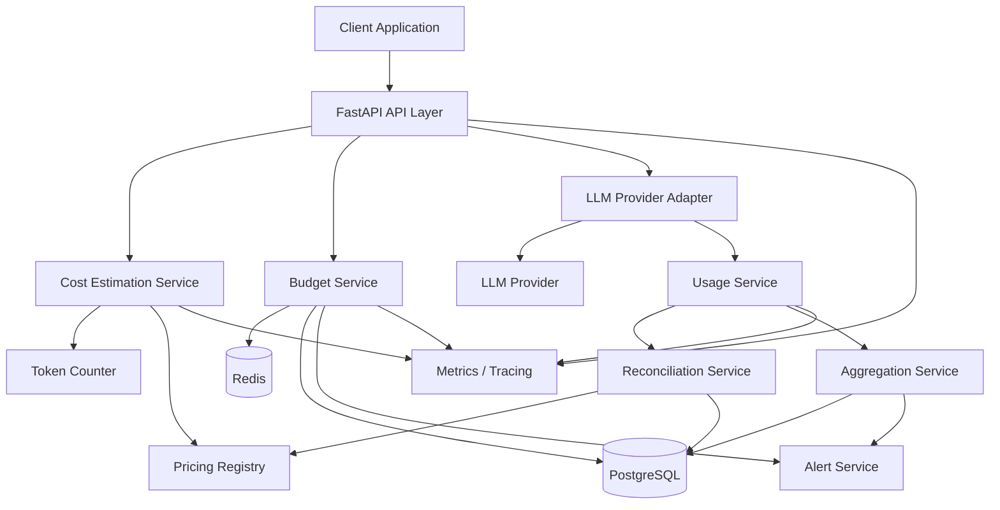
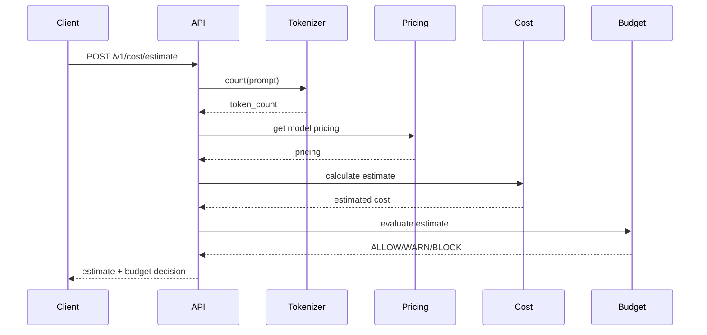
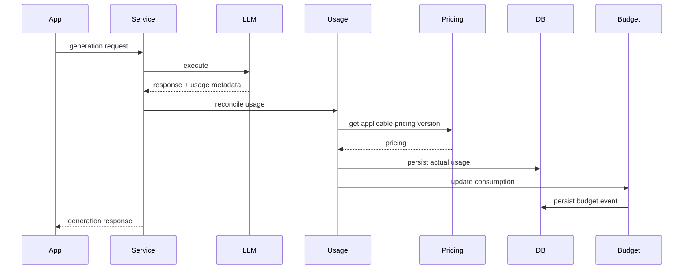
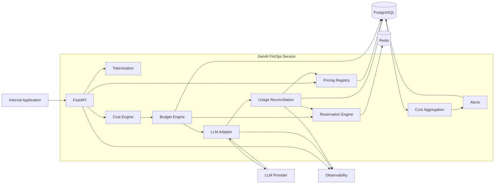

# Project 02 — GenAI Token Cost Estimator & FinOps Service

> **Status:** Design / Planning  
> **Primary Stack:** Python, FastAPI, PostgreSQL, Redis, SQLAlchemy, Alembic, Pydantic, pytest, Docker  
> **Primary Goal:** Estimate LLM cost before generation, track actual usage after generation, attribute spend, enforce budgets, and detect cost anomalies.

---

# 1. Executive Summary

This project builds a production-grade **GenAI FinOps Service**.

It is not merely a token calculator.

The system must answer five important questions:

1. **How much will this LLM request approximately cost before execution?**
2. **How much did it actually cost after execution?**
3. **Where is our GenAI spend going?**
4. **Should this request be allowed based on the available budget?**
5. **Can we detect unusual or dangerous spending before it becomes expensive?**

The core lifecycle is:

```text
Estimate
   ↓
Budget Check
   ↓
Authorize
   ↓
LLM Execution
   ↓
Actual Usage Capture
   ↓
Cost Reconciliation
   ↓
Persist Usage
   ↓
Aggregate Spend
   ↓
Budget Update
   ↓
Alert / Block / Report
```

---

# 2. What This Project Proves

This project should demonstrate that the engineer understands:

- LLM tokenization
- LLM pricing economics
- input vs output token costs
- cached-token pricing
- cost estimation
- actual usage reconciliation
- Decimal-safe financial calculations
- abstraction over LLM providers
- pricing versioning
- budget enforcement
- concurrency problems
- Redis atomic counters
- PostgreSQL transactional data
- audit trails
- anomaly detection
- observability
- API design
- production error handling
- Docker
- testing
- CI/CD
- GenAI FinOps architecture

---

# 3. Product Vision

Build a reusable service that applications can call before and after invoking an LLM.

Example:

```text
Application
    |
    | "Can I execute this request?"
    v
Token Cost Service
    |
    | estimated_cost = $0.034
    | budget_status = ALLOWED
    v
Application
    |
    | calls LLM
    v
LLM Provider
    |
    | actual usage
    v
Token Cost Service
    |
    | actual_cost = $0.029
    | persist + aggregate + alert
```

Eventually Project 1 — Production API Wrapper — can use this service as part of its preflight authorization pipeline.

---

# 4. Product Goals

The service must support:

- estimated token count before generation
- estimated request cost
- actual usage tracking
- actual cost calculation
- estimate-vs-actual reconciliation
- cost attribution
- model pricing registry
- pricing versioning
- budget creation
- budget thresholds
- budget enforcement
- usage aggregation
- alert generation
- cost anomaly detection
- auditability
- metrics
- provider extensibility

---

# 5. Non-Goals — Initial Version

Do not over-engineer Version 1.

Initially we will NOT build:

- enterprise billing/invoicing
- credit-card payments
- Kubernetes deployment
- machine-learning-based anomaly detection
- complex forecasting models
- multi-region active-active architecture
- dozens of LLM providers
- full React analytics dashboard
- organization-wide IAM platform

Start with APIs and production-quality backend architecture.

---

# 6. Core User Personas

## 6.1 Developer

Wants to know:

```text
How expensive is this request?
```

## 6.2 Engineering Lead

Wants:

```text
Cost by endpoint
Cost by model
Cost by team
Cost by application
```

## 6.3 Platform Engineer

Wants:

```text
Centralized model pricing
Centralized budget policies
Centralized enforcement
```

## 6.4 Engineering Manager

Wants:

```text
Monthly spend
Budget consumption
Cost trends
Anomalies
```

---

# 7. Primary Use Cases

## UC-01 — Estimate request cost

Input:

```json
{
  "provider": "openai",
  "model": "example-model",
  "prompt": "Explain microservices...",
  "expected_output_tokens": 500
}
```

Output:

```json
{
  "estimated_input_tokens": 120,
  "estimated_output_tokens": 500,
  "estimated_cost": "0.004250",
  "currency": "USD"
}
```

---

## UC-02 — Preflight budget check

Before an LLM request:

```text
Estimated Request Cost = $5
Remaining Budget       = $3
```

System result:

```text
BLOCK
```

---

## UC-03 — Track actual LLM usage

Provider response contains:

```text
Input tokens
Output tokens
Cached tokens where available
```

Store actual usage and calculate cost.

---

## UC-04 — Reconcile estimate vs actual

```text
Estimated Cost = $0.031
Actual Cost    = $0.026
Variance       = -$0.005
```

---

## UC-05 — Track spend per endpoint

Example:

```text
POST /generate-summary       $32
POST /generate-email         $14
POST /document-analysis      $87
```

---

## UC-06 — Budget enforcement

Example:

```text
Monthly Budget = $1,000

Consumed = $750
Status   = WARNING

Consumed = $950
Status   = CRITICAL

Consumed >= $1,000
Status = BLOCKED
```

---

## UC-07 — Cost anomaly detection

Historical average request:

```text
$0.03
```

Current request:

```text
$15
```

Generate:

```text
COST_ANOMALY
```

---

# 8. Functional Requirements

## FR-01 Token Estimation

The system shall estimate input tokens from input content.

---

## FR-02 Output Estimation

Caller shall provide either:

```text
expected_output_tokens
```

or:

```text
max_output_tokens
```

---

## FR-03 Pricing Registry

Pricing must not be hardcoded throughout application logic.

Pricing must come through:

```text
PricingProvider
```

---

## FR-04 Cost Calculation

The service shall calculate:

- input cost
- cached-input cost
- output cost
- total estimated cost
- total actual cost

---

## FR-05 Usage Tracking

Each LLM interaction shall generate a usage record.

---

## FR-06 Cost Attribution

Usage should support attributes such as:

```text
request_id
provider
model
endpoint
application
team
user_id
environment
```

---

## FR-07 Budget Management

Budgets must support:

```text
monthly
daily
application
team
user
endpoint
```

Initial implementation may support monthly team/application budgets first.

---

## FR-08 Budget Enforcement

The system must support:

```text
ALLOW
WARN
REQUIRE_OVERRIDE
BLOCK
```

---

## FR-09 Alerts

Generate alerts when configurable thresholds are crossed.

Example:

```text
70%
90%
100%
```

---

## FR-10 Usage Aggregation

Support reporting:

```text
by model
by endpoint
by application
by team
by date range
```

---

# 9. Non-Functional Requirements

## Performance

Cost-estimation endpoint target:

```text
p95 < 100 ms
```

excluding external network dependencies.

---

## Reliability

Cost calculation must be deterministic.

---

## Financial Accuracy

Never use binary floating-point for monetary calculations.

Use:

```python
Decimal
```

---

## Extensibility

Adding a new provider should not require rewriting the business logic.

---

## Observability

Every request must have:

```text
request_id
correlation_id
structured logs
metrics
trace context
```

---

## Security

Never persist:

```text
API keys
raw secrets
sensitive prompt data unnecessarily
```

---

# 10. High-Level Architecture — HLD



---

# 11. Core Architectural Principle

Business logic must depend on abstractions.

Preferred:

```text
CostEstimator
     |
     +--> TokenCounter
     |
     +--> PricingProvider
```

Avoid:

```python
if model == "...":
    ...
elif model == "...":
    ...
```

---

# 12. Service Boundaries

## API Layer

Responsible for:

- HTTP parsing
- Pydantic validation
- authentication context
- response formatting
- exception translation

Must NOT contain cost calculation logic.

---

## TokenCounter

Responsible for:

```text
text → token count
```

Interface concept:

```python
class TokenCounter:
    def count(
        self,
        model: str,
        text: str
    ) -> int:
        ...
```

Provider-specific implementations may exist later.

---

## PricingProvider

Responsible for returning pricing.

Concept:

```python
class PricingProvider:
    def get_pricing(
        self,
        provider: str,
        model: str
    ) -> ModelPricing:
        ...
```

---

## CostCalculator

Pure business logic.

Inputs:

```text
token usage
pricing
```

Output:

```text
cost breakdown
```

Should ideally have no database dependency.

---

## BudgetService

Responsible for:

- finding applicable budget
- remaining budget
- threshold evaluation
- authorization decisions
- reservations where required

---

## UsageService

Responsible for:

- recording actual usage
- metadata attribution
- reconciliation
- persistence

---

## AlertService

Responsible for:

- threshold alerts
- anomalies
- budget alerts

Initial implementation may only persist alerts and log them.

Notification integrations can come later.

---

# 13. Low-Level Architecture — LLD

Suggested source structure:

```text
src/
└── app/
    │
    ├── main.py
    │
    ├── api/
    │   ├── dependencies.py
    │   └── v1/
    │       ├── routes_cost.py
    │       ├── routes_usage.py
    │       ├── routes_budget.py
    │       ├── routes_pricing.py
    │       └── routes_health.py
    │
    ├── core/
    │   ├── config.py
    │   ├── exceptions.py
    │   ├── logging.py
    │   └── telemetry.py
    │
    ├── domain/
    │   ├── pricing.py
    │   ├── usage.py
    │   ├── budget.py
    │   └── cost.py
    │
    ├── schemas/
    │   ├── cost.py
    │   ├── usage.py
    │   ├── budget.py
    │   └── pricing.py
    │
    ├── services/
    │   ├── cost_estimator.py
    │   ├── cost_calculator.py
    │   ├── usage_service.py
    │   ├── reconciliation_service.py
    │   ├── budget_service.py
    │   ├── aggregation_service.py
    │   └── alert_service.py
    │
    ├── providers/
    │   ├── tokenizers/
    │   │   ├── base.py
    │   │   └── openai_tokenizer.py
    │   │
    │   ├── pricing/
    │   │   ├── base.py
    │   │   └── database_pricing.py
    │   │
    │   └── llm/
    │       ├── base.py
    │       └── openai_provider.py
    │
    ├── repositories/
    │   ├── usage_repository.py
    │   ├── pricing_repository.py
    │   ├── budget_repository.py
    │   └── alert_repository.py
    │
    ├── db/
    │   ├── base.py
    │   ├── session.py
    │   └── models/
    │
    └── utils/
        └── money.py
```

---

# 14. Complete Repository Structure

```text
Project-02-Token-Cost-Estimator/
│
├── README.md
├── Implementation.md
├── AGENTS.md
├── pyproject.toml
├── .env.example
├── .gitignore
├── docker-compose.yml
│
├── src/
│
├── tests/
│   ├── unit/
│   ├── integration/
│   └── contract/
│
├── migrations/
│
├── docs/
│   ├── product/
│   │   └── PRD.md
│   │
│   ├── architecture/
│   │   ├── system-design.md
│   │   ├── api-design.md
│   │   ├── database-design.md
│   │   └── security-design.md
│   │
│   ├── operations/
│   │   ├── observability.md
│   │   ├── testing-strategy.md
│   │   └── production-scenarios.md
│   │
│   └── decisions/
│       └── README.md
│
├── plans/
│   └── implementation-plan.md
│
└── Learning/
    ├── README.md
    ├── learning-path.md
    │
    ├── concepts/
    │   ├── 01-tokenization.md
    │   ├── 02-llm-pricing.md
    │   ├── 03-cost-calculation.md
    │   ├── 04-usage-reconciliation.md
    │   ├── 05-budget-management.md
    │   ├── 06-redis-and-concurrency.md
    │   ├── 07-observability.md
    │   └── 08-production-finops.md
    │
    ├── scenarios/
    │   ├── expensive-request.md
    │   ├── budget-exceeded.md
    │   ├── pricing-change.md
    │   ├── concurrent-budget-usage.md
    │   └── provider-failure.md
    │
    └── interview/
        └── questions-and-answers.md
```

---

# 15. Database Design

Initial entities:

```text
model_pricing
usage_records
budgets
budget_events
alerts
```

---

# 16. model_pricing

Suggested fields:

```text
id
provider
model
input_price_per_token
cached_input_price_per_token
output_price_per_token

currency

effective_from
effective_to

version

created_at
updated_at
```

Better storage may retain normalized pricing units such as price-per-million tokens while domain logic converts safely.

Important requirement:

**Historical costs must never change because current pricing changes.**

---

# 17. usage_records

Suggested fields:

```text
id
request_id
correlation_id

provider
model

application_id
team_id
user_id

endpoint
environment

estimated_input_tokens
estimated_output_tokens
estimated_cost

actual_input_tokens
cached_input_tokens
actual_output_tokens
actual_cost

pricing_version

status

started_at
completed_at
created_at
```

---

# 18. budgets

Suggested fields:

```text
id

scope_type
scope_id

period_type

limit_amount
currency

warning_threshold
critical_threshold

enforcement_mode

starts_at
ends_at

created_at
updated_at
```

Example:

```text
scope_type = TEAM
scope_id   = team-ai

period_type = MONTHLY

limit = $1,000
```

---

# 19. alerts

Fields:

```text
id
alert_type
severity

scope_type
scope_id

request_id

message
metadata

created_at
acknowledged_at
```

---

# 20. Pricing Versioning

Never perform historical reporting using today's pricing.

Example:

```text
January:

model-x
input = X
output = Y
pricing_version = 3
```

February pricing changes.

January usage records must continue using:

```text
pricing_version = 3
```

not the new version.

---

# 21. Cost Calculation Model

Conceptually:

```text
input_cost =
uncached_input_tokens
×
input_rate
```

```text
cached_cost =
cached_input_tokens
×
cached_input_rate
```

```text
output_cost =
output_tokens
×
output_rate
```

```text
total_cost =
input_cost
+
cached_cost
+
output_cost
```

Use:

```python
Decimal
```

for money.

Never:

```python
float
```

for financial calculations.

---

# 22. Estimation Flow



---

# 23. Actual Usage Flow



---

# 24. Estimate vs Actual Reconciliation

Example:

```text
Estimated Input Tokens  = 2,500
Actual Input Tokens     = 2,320

Estimated Output Tokens = 1,000
Actual Output Tokens    = 720

Estimated Cost          = $0.031
Actual Cost             = $0.025
```

Calculate:

```text
absolute variance
percentage variance
token variance
```

This data later allows better forecasting.

---

# 25. Budget Architecture

Naive implementation:

```text
Read current usage
      ↓
Check remaining amount
      ↓
Call LLM
      ↓
Increase usage
```

This has a race condition.

Example:

```text
Remaining budget = $5

Request A estimates $4
Request B estimates $4
```

Both read:

```text
remaining = $5
```

Both are accepted.

Total:

```text
$8
```

Budget exceeded.

---

# 26. Budget Reservation Pattern

Better architecture:

```text
Estimate
   ↓
Atomic budget reservation
   ↓
LLM execution
   ↓
Actual usage
   ↓
Reconcile reservation
```

Example:

```text
Reserve $5
Actual request = $3.80

Release:

$1.20
```

Redis can be used for fast atomic reservation/counter operations.

PostgreSQL remains the durable source of record.

---

# 27. Budget Decision Model

Possible statuses:

```text
ALLOW
WARN
CRITICAL
REQUIRE_OVERRIDE
BLOCK
```

Example policy:

```text
0–70%
ALLOW

70–90%
WARN

90–100%
CRITICAL

>=100%
BLOCK
```

Must be configurable.

---

# 28. API Design

Initial APIs:

```text
POST /v1/cost/estimate

POST /v1/usage

GET /v1/usage
GET /v1/usage/summary

GET /v1/cost/by-model
GET /v1/cost/by-endpoint
GET /v1/cost/by-team

POST /v1/budgets
GET /v1/budgets/{id}
PATCH /v1/budgets/{id}

GET /v1/models/pricing
POST /v1/models/pricing

GET /health
GET /ready
```

---

# 29. POST /v1/cost/estimate

Request:

```json
{
  "provider": "openai",
  "model": "example-model",
  "input": "Explain distributed transactions",
  "expected_output_tokens": 800,
  "application_id": "architecture-assistant",
  "team_id": "platform-team",
  "endpoint": "/generate"
}
```

Response:

```json
{
  "request_id": "req_xxx",
  "provider": "openai",
  "model": "example-model",

  "estimated_input_tokens": 124,
  "estimated_output_tokens": 800,

  "estimated_input_cost": "0.0012",
  "estimated_output_cost": "0.0048",
  "estimated_total_cost": "0.0060",

  "currency": "USD",

  "budget": {
    "status": "ALLOW",
    "remaining_before_request": "25.40",
    "remaining_after_estimate": "25.394"
  }
}
```

---

# 30. Error Model

Standard format:

```json
{
  "error": {
    "code": "MODEL_PRICING_NOT_FOUND",
    "message": "Pricing configuration was not found.",
    "request_id": "req_xxx"
  }
}
```

Possible codes:

```text
VALIDATION_ERROR
MODEL_NOT_SUPPORTED
MODEL_PRICING_NOT_FOUND
TOKENIZATION_FAILED
BUDGET_EXCEEDED
BUDGET_RESERVATION_FAILED
USAGE_RECONCILIATION_FAILED
DATABASE_ERROR
REDIS_UNAVAILABLE
PROVIDER_ERROR
INTERNAL_ERROR
```

---

# 31. Redis Responsibilities

Redis should NOT become the permanent system of record.

Use Redis for:

```text
budget counters
budget reservations
frequently-used pricing cache
distributed locking if required
short-lived aggregation
```

Use PostgreSQL for:

```text
durable usage records
pricing history
budget definitions
alerts
auditability
```

---

# 32. Cache Strategy

Model pricing is read frequently but changes rarely.

Recommended flow:

```text
Cost Service
    |
Redis Pricing Cache
    |
Cache miss
    ↓
PostgreSQL
```

Use explicit cache invalidation when pricing configuration changes.

---

# 33. Cost Anomaly Detection — V1

Do not start with machine learning.

Start with configurable rules.

Example:

```text
If estimated_request_cost > configured_request_limit:
    FLAG
```

or:

```text
current_cost >
historical_average × anomaly_multiplier
```

V2 may implement more advanced statistics.

---

# 34. Security

Required principles:

- API authentication
- authorization around budget/pricing administration
- API keys through environment/secrets
- no secrets committed
- validation for all input
- prompt size limits
- maximum token limits
- request metadata sanitization
- avoid storing prompt content by default
- structured audit events
- rate limiting where appropriate
- TLS in production
- least privilege database credentials

---

# 35. Observability

Implement:

## Logs

Structured JSON logs containing:

```text
timestamp
level
request_id
correlation_id
endpoint
provider
model
team_id
application_id
latency
status
```

Do not log raw sensitive prompts.

---

## Metrics

Useful metrics:

```text
llm_requests_total

llm_input_tokens_total

llm_output_tokens_total

llm_cost_total

llm_estimated_cost_total

llm_budget_rejections_total

llm_cost_anomaly_total

llm_request_duration_seconds
```

Dimensions:

```text
provider
model
endpoint
status
```

Avoid uncontrolled high-cardinality labels such as raw user IDs.

---

## Tracing

Expected trace:

```text
HTTP Request
   ↓
Tokenization
   ↓
Pricing Lookup
   ↓
Cost Estimation
   ↓
Budget Evaluation
   ↓
LLM Provider
   ↓
Usage Reconciliation
   ↓
Persistence
```

---

# 36. Testing Strategy

Testing must exist at multiple levels.

---

## Unit Tests

Test:

```text
token counter
pricing lookup
cost calculator
budget rules
reconciliation
anomaly detection
```

Example test cases:

```text
zero tokens
very large token count
unknown model
missing pricing
cached tokens
zero output tokens
negative values rejected
pricing version changes
exact budget boundary
budget exceeded
```

---

## Integration Tests

Test:

```text
FastAPI + PostgreSQL
FastAPI + Redis
pricing repository
usage persistence
budget reservation
```

---

## Contract Tests

Validate provider adapters against expected usage response structures.

---

## Concurrency Tests

Critical.

Simulate many requests consuming the same budget.

Verify:

```text
budget cannot be overspent because of race conditions
```

---

## Load Tests

Measure:

```text
estimate endpoint throughput
Redis budget operations
database writes
aggregation queries
```

---

# 37. Production Scenarios

Every scenario must eventually be documented under:

```text
Learning/scenarios/
```

---

## Scenario 1 — Unknown model

System receives unsupported model.

Expected:

```text
MODEL_PRICING_NOT_FOUND
```

No LLM call.

---

## Scenario 2 — Very large prompt

Estimated tokens exceed configured limit.

Expected:

```text
reject before LLM execution
```

---

## Scenario 3 — Request more expensive than remaining budget

Expected:

```text
BLOCK
```

---

## Scenario 4 — Concurrent requests

Multiple requests attempt to consume same budget.

Expected:

```text
atomic budget enforcement
```

---

## Scenario 5 — Pricing changed

New requests use new pricing.

Historical requests retain old pricing.

---

## Scenario 6 — Redis unavailable

System behavior must be explicitly defined.

Potential design:

```text
Fail closed for strict budget enforcement
```

rather than allowing uncontrolled spending.

---

## Scenario 7 — PostgreSQL temporarily unavailable

Do not silently lose usage information.

Depending on later architecture:

```text
retry
outbox/event queue
or fail request
```

Initial implementation should explicitly return failure rather than pretending tracking succeeded.

---

## Scenario 8 — LLM provider succeeds but usage persistence fails

This is an important distributed-system scenario.

The money has already been spent.

We cannot "undo" the LLM request.

Eventually consider:

```text
outbox
durable queue
retry worker
```

V1 may expose the failure clearly and create retry capability.

---

## Scenario 9 — Estimated cost drastically differs from actual

Record variance.

Generate anomaly when configured threshold exceeded.

---

# 38. Learning-First Implementation Rule

Codex/Claude must not simply build features.

Every major implementation phase must have corresponding learning documentation.

For each concept answer:

```text
WHAT is it?

WHY do we need it?

HOW does it work?

WHAT can fail?

HOW do we test it?

HOW does it scale?

WHAT alternatives exist?

HOW would I explain it in an interview?
```

---

# 39. Learning Path

Order:

```text
01 Tokenization

02 LLM Pricing

03 Decimal-safe Cost Calculation

04 Pricing Registry

05 Cost Estimation

06 Usage Tracking

07 Estimate vs Actual Reconciliation

08 PostgreSQL Data Modeling

09 Budget Management

10 Redis + Atomic Operations

11 Budget Reservations

12 Cost Aggregation

13 Anomaly Detection

14 Observability

15 Security

16 Testing

17 Docker

18 CI/CD

19 Production Failure Scenarios

20 GenAI FinOps Architecture
```

---

# 40. Implementation Phases

Do NOT implement everything in a single Codex prompt.

Each phase must be implemented, tested, reviewed, and understood independently.

---

# Phase 0 — Repository Foundation

Implement:

```text
folder structure
pyproject.toml
FastAPI skeleton
configuration
logging
health endpoint
test configuration
Docker development environment
PostgreSQL
Redis
Alembic
```

Learn:

```text
FastAPI project organization
dependency injection
configuration management
PostgreSQL vs Redis responsibilities
Alembic migrations
```

Acceptance:

```text
API starts
health works
database connects
Redis connects
tests run
```

---

# Phase 1 — Pricing Domain

Implement:

```text
ModelPricing domain model
PricingProvider interface
pricing database entity
repository
migration
admin pricing APIs
```

Learn:

```text
provider pricing
model pricing
versioning
repository pattern
dependency inversion
```

---

# Phase 2 — Tokenization

Implement:

```text
TokenCounter abstraction
provider-specific tokenizer
token estimation service
```

Learn:

```text
tokens
BPE conceptually
model-specific tokenization
characters vs words vs tokens
```

Tests:

```text
empty content
normal content
unicode
long prompt
unknown tokenizer/model
```

---

# Phase 3 — Cost Calculation Engine

Implement pure:

```text
CostCalculator
```

Learn:

```text
Decimal
financial precision
pure functions
domain services
```

Must return:

```text
input cost
cached cost
output cost
total
```

---

# Phase 4 — Cost Estimate API

Implement:

```text
POST /v1/cost/estimate
```

Flow:

```text
validate
↓
tokenize
↓
pricing
↓
calculate
↓
respond
```

---

# Phase 5 — Usage Ledger

Implement:

```text
usage_records
repository
POST /v1/usage
```

Learn:

```text
immutable ledger concepts
cost attribution
auditability
```

---

# Phase 6 — Reconciliation

Implement:

```text
estimated vs actual tokens
estimated vs actual costs
variance
```

Learn:

```text
why estimates cannot be treated as billing truth
```

---

# Phase 7 — Aggregation APIs

Implement:

```text
usage summary
cost by model
cost by endpoint
cost by team
cost by application
```

Learn:

```text
SQL aggregation
indexes
query performance
```

---

# Phase 8 — Budget Domain

Implement:

```text
Budget
BudgetPolicy
BudgetDecision
```

Learn:

```text
domain modeling
policy evaluation
```

---

# Phase 9 — Budget APIs

Implement:

```text
create
read
update
```

Validate:

```text
period
currency
thresholds
limits
```

---

# Phase 10 — Redis Budget Counter

Implement fast budget-consumption tracking.

Learn:

```text
Redis
atomic increment
TTL
distributed systems
```

---

# Phase 11 — Budget Reservation

Implement:

```text
reserve
commit
release
```

Learn:

```text
race conditions
atomic operations
distributed coordination
```

---

# Phase 12 — Preflight Enforcement

Integrate:

```text
cost estimate
+
budget reservation
```

Response:

```text
ALLOW
WARN
CRITICAL
BLOCK
```

---

# Phase 13 — Alert System

Implement:

```text
budget threshold alerts
cost anomaly alerts
persistence
structured logging
```

---

# Phase 14 — Provider Integration

Only now introduce actual LLM provider integration.

Implement abstraction:

```text
LLMProvider
```

Then initial provider.

Do NOT tightly couple core services to one provider SDK.

---

# Phase 15 — End-to-End Generation Flow

Final flow:

```text
Request
 ↓
Tokenize
 ↓
Estimate
 ↓
Budget Reserve
 ↓
LLM Call
 ↓
Actual Usage
 ↓
Actual Cost
 ↓
Reconcile
 ↓
Persist
 ↓
Commit/Release Reservation
 ↓
Alert
 ↓
Response
```

---

# Phase 16 — Observability

Add:

```text
structured logs
metrics
tracing
correlation IDs
```

---

# Phase 17 — Security Hardening

Add:

```text
authentication
authorization
rate limits
input size limits
secret handling
log redaction
```

---

# Phase 18 — Comprehensive Testing

Add:

```text
unit
integration
contract
concurrency
failure
load
```

---

# Phase 19 — Dockerization

Provide:

```text
application container
PostgreSQL
Redis
docker-compose
health checks
```

---

# Phase 20 — CI Pipeline

Pipeline:

```text
checkout
↓
install
↓
lint
↓
type check
↓
unit tests
↓
integration tests
↓
security checks
↓
build container
```

---

# Phase 21 — Documentation

Complete:

```text
README
PRD
architecture
API docs
database docs
security
observability
testing
production scenarios
Learning/
interview questions
```

---

# Phase 22 — Portfolio Demo

Demo scenario:

```text
Team budget = $10

Normal request
↓
cost estimated
↓
allowed
↓
actual usage tracked


Large request
↓
estimated
↓
budget insufficient
↓
blocked BEFORE provider call


Multiple requests
↓
usage aggregated
↓
budget crosses threshold
↓
alert created
```

---

# 41. Definition of Done

Project is NOT complete just because endpoints work.

Complete means:

- cost estimation works
- actual usage tracking works
- Decimal calculations are used
- pricing is versioned
- historical records remain stable
- provider abstraction exists
- token-counter abstraction exists
- cost calculator independently testable
- PostgreSQL usage ledger exists
- Redis budget mechanism exists
- budget enforcement works
- concurrency is tested
- estimate-vs-actual reconciliation works
- aggregation APIs work
- alerts work
- observability exists
- security controls exist
- unit tests exist
- integration tests exist
- Docker works
- CI works
- learning documentation exists
- interview Q&A exists
- architecture documentation exists
- production scenarios documented

---

# 42. Architecture Decision Records

Important decisions should eventually become ADRs.

Examples:

```text
ADR-001 Use Decimal for monetary values

ADR-002 PostgreSQL as durable system of record

ADR-003 Redis for atomic budget reservations

ADR-004 Separate pricing provider from cost calculator

ADR-005 Store pricing version with usage records

ADR-006 Fail closed when strict budget enforcement is unavailable

ADR-007 Avoid raw prompt persistence by default
```

---

# 43. AGENTS.md Guidance

Codex and Claude should follow these rules.

```text
1. Read Implementation.md before making architectural changes.

2. Work on only one implementation phase at a time.

3. Do not implement future phases unless explicitly requested.

4. Before implementation, identify:
   - requirement
   - affected components
   - files
   - tests
   - learning concepts

5. Core domain logic must remain independent of FastAPI.

6. Do not hardcode LLM prices inside business logic.

7. Financial calculations must use Decimal.

8. External providers must sit behind interfaces/adapters.

9. Do not persist secrets.

10. Avoid storing raw user prompts unless explicitly required.

11. Every feature requires tests.

12. Every meaningful architectural decision should be documented.

13. Do not silently alter API contracts.

14. Do not silently add dependencies.

15. Prefer simple architecture until complexity is justified.

16. Redis is not the durable system of record.

17. PostgreSQL history must remain auditable.

18. Usage records must preserve pricing context/version.

19. Budget operations must account for concurrency.

20. Update relevant Learning documentation whenever a new engineering concept is introduced.
```

---

# 44. Required Coding-Agent Workflow

For every phase, Codex/Claude should first provide:

```text
PHASE

Goal

Requirements

Concepts involved

Files to create/change

Architecture impact

Data-flow impact

Potential failure scenarios

Tests to implement
```

Only after reviewing that should implementation begin.

After implementation, provide:

```text
What was implemented

Why it was implemented this way

Files changed

Important code flow

Tests added

How to run

What I must learn

Interview questions created

Remaining risks

Next phase
```

---

# 45. Learning Gate

Before proceeding from one major phase to another, the developer should be able to answer questions related to that phase.

Example after Cost Calculator:

```text
Why Decimal instead of float?

Why keep CostCalculator independent from FastAPI?

How is cached-input cost different?

Why should pricing not be hardcoded?

How do we version pricing?

What happens when a model has no pricing configuration?
```

If these cannot be explained clearly, do not blindly continue implementation.

---

# 46. Final Target Architecture



---

# 47. Relationship With Project 1

Project 2 should remain independently deployable.

Later:

```text
Production API Wrapper
        |
        | preflight
        v
Token Cost / FinOps Service
        |
   ALLOW / BLOCK
        |
        v
LLM Provider
```

This creates clear boundaries.

Project 1 proves:

```text
Production API engineering
```

Project 2 proves:

```text
GenAI economics + FinOps + cost governance
```

Together they become significantly stronger.

---

# 48. Implementation Philosophy

Do not optimize for:

```text
"How quickly can Codex finish this?"
```

Optimize for:

```text
"Can I explain why every important component exists?"
```

The engineering loop is:

```text
UNDERSTAND
    ↓
DESIGN
    ↓
IMPLEMENT
    ↓
TEST
    ↓
BREAK
    ↓
OBSERVE
    ↓
FIX
    ↓
DOCUMENT
    ↓
EXPLAIN
```

That is the actual objective of Project 2.

---

# 49. Starting Point

The first implementation task must be:

```text
PHASE 0 — Repository Foundation
```

Before writing code, Codex/Claude must inspect this document and propose:

```text
1. exact repository tree
2. dependencies
3. configuration strategy
4. database/Redis local environment
5. test setup
6. files that Phase 0 will create
7. Phase 0 acceptance criteria
```

Do not implement Phase 1 or later until Phase 0 has been reviewed and completed successfully.