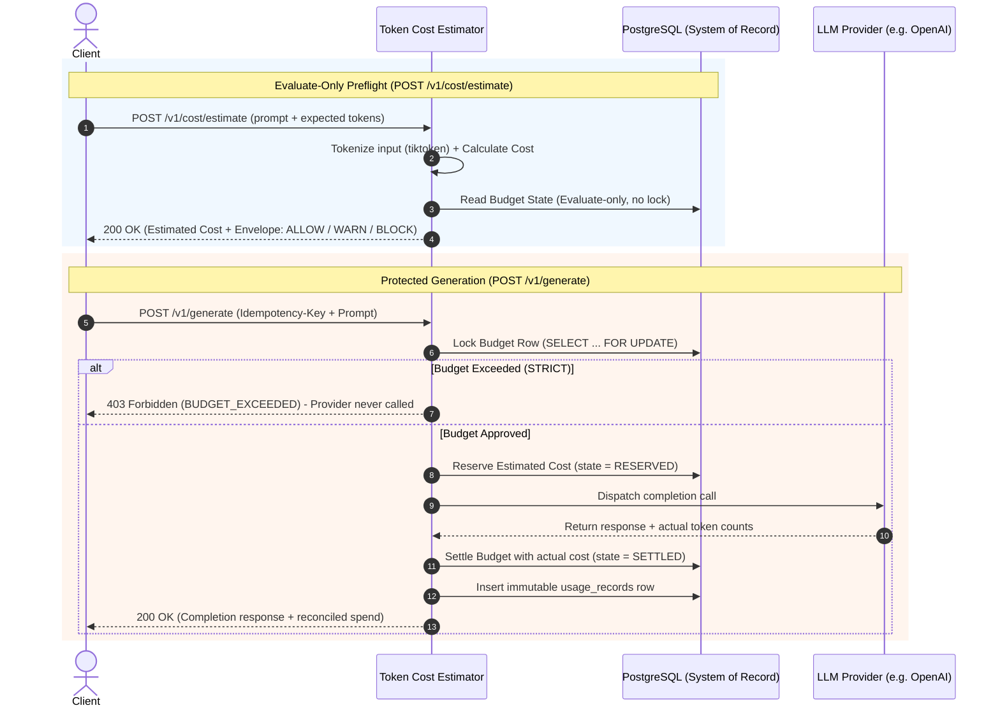

# Token Cost Estimator — GenAI FinOps & Gateway Service

[](https://github.com/pranjulya/token-fin-cost-estimator-genAI/actions/workflows/ci.yml)
[](https://www.python.org/downloads/)
[](https://fastapi.tiangolo.com)
[](https://www.postgresql.org/)
[](https://github.com/astral-sh/ruff)
[](https://mypy.readthedocs.io/)
[](docs/testing.md)
[](LICENSE)

A high-throughput **GenAI FinOps & Gateway Service** designed to prevent LLM budget overruns before they occur. It provides pre-flight tokenization and cost estimation, enforces atomic team/application budget limits via database row-locking, reconciles estimates against actual provider usage, and surfaces spend attribution analytics and anomaly alerts.

Built with **Python 3.12, FastAPI, SQLAlchemy 2.0 (Async), PostgreSQL, and Alembic**.

---

## 🎯 Target Audience & Learning Outcomes

### Who Is This For?
- **Engineers & Architects** — evaluating production FinOps patterns for enterprise GenAI applications (preflight evaluation, reserve-call-settle lifecycle, atomic concurrency control).
- **Backend Developers & Students** — studying real-world asynchronous Python architectures, strict typing (`mypy --strict`), clean hexagonal boundaries, and zero-drift `Decimal` accounting.
- **Interview & System Design Preparation** — explore [`Learning/`](Learning/) for a structured walkthrough and system design Q&A.

> **Budget Preflight vs. Execution:** `POST /v1/cost/estimate` is **evaluate-only** — it computes token costs and returns a budget envelope (`ALLOW`/`WARN`/`CRITICAL`/`BLOCK`) without locking or reserving funds. `POST /v1/generate` is the atomic execution path that reserves spend, calls the provider, and settles the ledger.

---

## ⚡ Key Architecture & Engineering Highlights

| Capability | Technical Implementation | Why It Matters |
|---|---|---|
| **Decimal-Safe Financial Math** | Custom `Decimal` fixed-point arithmetic (`src/app/utils/money.py`) | Eliminates binary floating-point rounding drift across millions of micro-transactions. |
| **Atomic Budget Reservation** | PostgreSQL `SELECT ... FOR UPDATE` row-level locks on budget periods | Guarantees strict budget ceilings under high concurrent traffic without distributed race conditions. |
| **Self-Healing Sweeper** | Two-phase lease-based background recovery worker (`reservation_sweeper`) | Automatically releases orphaned spend reservations if upstream LLM calls or client processes crash. |
| **Immutable Pricing History** | Foreign key snapshotting on `pricing_version` per usage record | Historical financial reporting remains accurate even when model pricing changes over time. |
| **Zero Data Leakage** | Prompt/completion content is processed ephemerally in-memory and never persisted | Complete compliance with enterprise privacy standards and SOC2/HIPAA data hygiene. |
| **Clean Hexagonal Architecture** | Strict boundary separation between API, pure domain logic, and DB drivers | Providers (`TokenCounter`, `PricingProvider`, `LLMProvider`) sit behind `Protocol` interfaces. |

---

## 🏗️ System Architecture & Lifecycle

### Request Flow: Preflight Estimate vs. Guaranteed Generation



---

## 🚀 Quick Start

### Docker Compose (Recommended)

Spins up the FastAPI application and a dedicated PostgreSQL 14 instance with automatic health checks and idempotent pricing seeding:

```bash
# Clone and boot the environment
git clone https://github.com/pranjulya/token-fin-cost-estimator-genAI.git
cd token-fin-cost-estimator-genAI
docker compose up --build
```

- **OpenAPI Documentation:** [http://localhost:8000/docs](http://localhost:8000/docs)
- **Health Probes:** [http://localhost:8000/health](http://localhost:8000/health) & `/ready`
- **Prometheus Metrics:** [http://localhost:8000/metrics](http://localhost:8000/metrics)
- **Default Auth Keys:** `dev-user-key` (standard) / `dev-admin-key` (administrative endpoints)

### Local Development (macOS / Linux)

Requires Python 3.12, PostgreSQL 14+, and [uv](https://docs.astral.sh/uv/):

```bash
# 1. Install dependencies, create databases, migrate, and seed pricing
make setup

# 2. Start the local development server with auto-reload
make run
```

---

## 🎬 Interactive Portfolio Demo

Run the self-contained portfolio demo to verify all core flows (normal usage, strict budget rejection, aggregation, and anomaly alerts) using an in-process mock LLM without spending real money or requiring third-party API keys:

```bash
make demo
```

```text
== Beat 1: Normal request ==
  [estimate] status=200 budget=ALLOW cost=0.00101750
  [usage] status=201 actual_cost=0.00033750 variance=0.00033750

== Beat 2: Large request (blocked before provider) ==
  [estimate] status=200 budget=BLOCK
  [generate] status=403 code=BUDGET_EXCEEDED (Zero upstream provider calls made)

== Beat 3: Multiple requests -> threshold + alert ==
  [summary] requests=7 cost=0.00236250
  [by-model] model=gpt-4o cost=0.00236250
  [alerts] count=1 (BUDGET_THRESHOLD alert generated)
  [ack] alert_id=1 -> 200 OK
```

---

## 📡 API Surface & Usage Examples

All `/v1/*` routes require an `X-API-Key` or `Authorization: Bearer <key>` header.

### 1. Pre-flight Cost Estimation
Tokenize prompt and calculate cost against current active model rates:

```bash
curl -X POST http://localhost:8000/v1/cost/estimate \
  -H "X-API-Key: dev-user-key" \
  -H "Content-Type: application/json" \
  -d '{
    "provider": "openai",
    "model": "gpt-4o",
    "input": "Analyze quarterly cloud spend and generate executive summary.",
    "expected_output_tokens": 500,
    "team_id": "analytics"
  }'
```

```json
{
  "estimated_input_tokens": 10,
  "estimated_output_tokens": 500,
  "estimated_input_cost": "0.00005000",
  "estimated_output_cost": "0.00500000",
  "estimated_total_cost": "0.00505000",
  "currency": "USD",
  "pricing_version": 1,
  "budget_status": "ALLOW"
}
```

### 2. End-to-End Generation (Atomic Budget Lock)
Executes budget reservation, makes the LLM call, records actual usage, and settles spend:

```bash
curl -X POST http://localhost:8000/v1/generate \
  -H "X-API-Key: dev-user-key" \
  -H "Idempotency-Key: req_gen_01" \
  -H "Content-Type: application/json" \
  -d '{
    "provider": "openai",
    "model": "gpt-4o",
    "prompt": "Explain raft consensus in two sentences.",
    "expected_output_tokens": 100,
    "team_id": "core-infra"
  }'
```

### 3. Spend Attribution Analytics
Retrieve multi-dimensional spend aggregations:

```bash
# Spend by Model
curl http://localhost:8000/v1/cost/by-model -H "X-API-Key: dev-user-key"

# Spend by Team
curl http://localhost:8000/v1/cost/by-team -H "X-API-Key: dev-user-key"

# Global Usage Summary
curl http://localhost:8000/v1/usage/summary -H "X-API-Key: dev-user-key"
```

---

## 📊 Observability & Prometheus Metrics

Exposed at `/metrics` (Prometheus text format) with zero-cost scraping overhead:

| Metric | Type | Labels | Purpose |
|---|---|---|---|
| `llm_requests_total` | Counter | `provider`, `model`, `status` | Total request volume |
| `llm_cost_total` | Counter | `provider`, `model`, `team_id` | Cumulative realized financial spend |
| `llm_estimated_cost_total` | Counter | `provider`, `model` | Pre-flight estimated spend |
| `llm_budget_rejections_total` | Counter | `budget_id`, `scope` | Requests blocked before provider execution |
| `llm_cost_anomaly_total` | Counter | `model`, `severity` | Number of cost anomaly spikes detected |
| `llm_request_duration_seconds` | Histogram | `endpoint`, `status` | End-to-end API latency distribution |

---

## 🛡️ Security & Rate Limiting

- **Scope Separation:** Granular separation between standard `user` tokens and `admin` tokens (governing pricing updates, budget administration, and alert lifecycle).
- **Key Hashing:** Optional `APP_AUTH_HASH_KEYS=true` allows storing only SHA-256 digests in environment/secrets managers.
- **In-Memory Token Bucket Rate Limiting:** Enforces independent per-key burst/rate thresholds (`APP_RATE_LIMIT_PER_MINUTE` and `APP_RATE_LIMIT_GENERATE_PER_MINUTE`).
- **Structured Log Redaction:** Structlog processor automatically redacts authorization headers, API keys, and sensitive payloads.

---

## 🏛️ Architecture Decision Records (ADRs)

Key technical tradeoffs and architectural choices are thoroughly documented in [`docs/adr/`](docs/adr/):

- **[ADR-001: Decimal Money Representation](docs/adr/ADR-001-decimal-money.md)** — Why IEEE-754 floats are banned for financial math.
- **[ADR-002: PostgreSQL as System of Record](docs/adr/ADR-002-postgres-system-of-record.md)** — ACID guarantees for ledger and budgets.
- **[ADR-003: Postgres `FOR UPDATE` vs. Redis for Budgets](docs/adr/ADR-003-postgres-for-update-not-redis.md)** — Eliminating dual-write inconsistency.
- **[ADR-004: Decoupled Pricing Providers](docs/adr/ADR-004-pricing-provider-separated.md)** — Extensible multi-model pricing architecture.
- **[ADR-005: Pricing Snapshot Versioning on Usage](docs/adr/ADR-005-pricing-version-on-usage.md)** — Guaranteeing audit stability against rate changes.
- **[ADR-006: Fail-Closed Budget Policy](docs/adr/ADR-006-fail-closed-budget.md)** — Guaranteeing budget protection during edge cases.
- **[ADR-007: Zero Raw Prompt Persistence](docs/adr/ADR-007-no-raw-prompt-persistence.md)** — Privacy-first data retention policy.

---

## 🧪 Testing & Quality Assurance

The codebase enforces strict quality gates on every commit and pull request:

```bash
# Run complete test suite (Unit, Integration, Contract against live Postgres)
make test

# Enforce strict 80%+ branch test coverage gate
make coverage

# Static type analysis with mypy strict mode
make typecheck

# Code formatting and linting checks with ruff
make lint

# Dependency vulnerability and secret scanning
make security-check
```

---

## 📁 Repository Structure

```
token-fin-cost-estimator-genAI/
├── src/app/
│   ├── api/v1/          # FastAPI route handlers & dependency injection
│   ├── core/            # App configuration, structured logging, exceptions
│   ├── db/              # SQLAlchemy 2.0 async engine, models, & base schemas
│   ├── domain/          # Pure business logic (Cost, Pricing, Usage models)
│   ├── providers/       # Tokenizers (tiktoken), Pricing providers, LLM clients
│   ├── repositories/    # Database access layers (Usage, Budget, Pricing)
│   ├── schemas/         # Pydantic v2 request/response contracts
│   ├── services/        # Orchestration (CostEstimator, BudgetService, Reconciler)
│   └── utils/           # Financial Decimal math helpers
├── docs/                # Architecture docs, PRD, production scenarios, & ADRs
├── migrations/          # Version-controlled Alembic schema migrations
├── scripts/             # Seed data, benchmark helpers, and interactive demo
├── tests/
│   ├── unit/            # Fast, isolated domain logic tests
│   ├── integration/     # Database-backed repository and service tests
│   └── contract/        # HTTP API envelope and status code tests
├── .github/             # GitHub Actions CI workflows, issue & PR templates
├── Dockerfile           # Multi-stage production container image
├── docker-compose.yml   # Dev orchestration with PostgreSQL 14
└── pyproject.toml       # Modern Python packaging with uv and hatchling
```

---

## 📄 License

Distributed under the [MIT License](LICENSE). Built for high-reliability production GenAI infrastructure.
