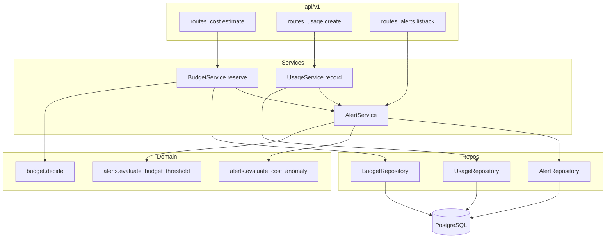

# Phase 13 — Alert System for GenAI Token Cost Estimator

| Field | Value |
|-------|-------|
| **Author** | Grok Design (Phase 13) |
| **Date** | 2026-08-12 |
| **Status** | Approved (design-review consensus; pending product go-ahead) |
| **Repo** | `/Users/pranjulyabajpai/src/genAI/token_cost_estimator` |
| **Parent PRD** | `# Project 02 — GenAI Token Cost Estimato.md` (FR-09, UC-07, AlertService, §19 alerts, Phase 13) |
| **Depends on** | Vertical slice (8bc2149), Budget domain + Postgres-atomic reserve (PR #1 / 8390ba6) |

> **PRD ↔ code status mapping:** PRD narrative sometimes uses `REQUIRE_OVERRIDE` / `BLOCKED`. This design follows **implemented** domain constants in `src/app/domain/budget.py`: `ALLOW` / `WARN` / `CRITICAL` / `BLOCK` only.

---

## Overview

Phase 13 adds an **Alert System** that turns existing budget decisions and usage reconciliation signals into durable, queryable records with structured logs. When a budget reserve crosses WARN / CRITICAL / BLOCK thresholds, or when a recorded request’s actual cost is anomalous relative to history (or extreme estimate variance), the system creates an `alerts` row and emits a structured log event.

This phase is **persist + log only** (YAGNI): no Slack, email, PagerDuty, or webhooks. Alerts plug into the existing layered architecture (`domain/` pure rules → `services/` orchestration → `repositories/` DB → thin routes) and hook the two live hot paths already in production of this codebase: `BudgetService.reserve` (called from `POST /v1/cost/estimate`) and `UsageService.record` (called from `POST /v1/usage`). Deduplication prevents retries and repeated reserves at the same severity band from flooding the table.

---

## Background & Motivation

### Current state

| Capability | Where it lives | Alert-related gap |
|------------|----------------|-------------------|
| Budget policy (`ALLOW` / `WARN` / `CRITICAL` / `BLOCK`) | `src/app/domain/budget.py::decide` | Status returned to API envelope only; no durable alert |
| Atomic reserve + `budget_events` | `src/app/services/budget_service.py`, `BudgetEvent` model | Comment explicitly defers alerts: *“Alerts (PRD Phase 13) read this later”* |
| Estimate preflight reserve | `src/app/api/v1/routes_cost.py` | Writes events; no alert side-effect |
| Usage ledger + reconciliation | `src/app/services/usage_service.py`, `ReconciliationService` | Variance stored on `usage_records`; no anomaly alert |
| Structured logging | `src/app/core/logging.py` (structlog) | Only app start/shutdown today |
| Aggregation | `AggregationService` / `UsageRepository` | Group-by cost; not used for per-request baselines |

### Pain points

1. **Budget thresholds are ephemeral.** A `WARN`/`CRITICAL`/`BLOCK` decision appears once in the estimate response and as a `budget_events` row, but operators cannot list “open budget alerts” or acknowledge them.
2. **UC-07 cost anomalies are invisible.** A `$15` request after a `$0.03` historical average is stored as a high `actual_cost` with no `COST_ANOMALY` signal.
3. **Retries can double-fire.** Usage is idempotent on `request_id`; budget reserves are not request-idempotent for events. Without a dedupe strategy, naive alert hooks would spam on retries or repeated near-limit reserves.
4. **PRD contract is incomplete without alerts.** FR-09 (70% / 90% / 100% threshold alerts), UC-07, Phase 13 checklist, and Definition of Done (“alerts work”) require this slice.

### Constraints carried from prior phases

- No Redis (budget used Postgres `FOR UPDATE` locks instead).
- No auth yet — alert read/ack APIs are unauthenticated like the rest of the service.
- Decimal-only money math (`app.utils.money`).
- Same session/transaction pattern via `get_db_session` (commit on success).

---

## Goals & Non-Goals

### Goals

1. Persist alerts matching PRD §19 fields as closely as practical.
2. Emit **budget threshold alerts** from reserve decisions at WARN / CRITICAL / BLOCK (aligned with budget `warning_threshold` / `critical_threshold`, default 0.70 / 0.90 → FR-09’s 70% / 90% / 100%).
3. Emit **cost anomaly alerts** from usage recording using **rule-based** detection (historical average + optional estimate-variance rule).
4. Structured logging on every newly created alert (`alert_created` event).
5. Deduplication so retries and repeated same-band decisions do not flood alerts.
6. Wire hooks without breaking usage idempotency or budget atomicity.
7. Minimal read/ack API for ops and integration tests.
8. Unit tests for pure rules + Postgres integration tests matching existing style.

### Non-Goals (explicit)

| Out of scope | Why |
|--------------|-----|
| Slack / email / PagerDuty / webhooks | YAGNI; PRD says “notification integrations can come later” |
| ML / statistical anomaly models | PRD: rule-based only this phase |
| Phase 14+ (LLM provider, E2E generation, Docker, auth) | Single-phase design |
| Redis-backed alert queues or workers | No Redis; sync in-request is enough |
| Changing budget policy thresholds or enforcement semantics | Already correct in `domain/budget.py` |
| Mutating historical `usage_records` / `budget_events` | Append-only audit stays intact |
| Alert aggregation dashboards / UI | API list is enough |
| Per-tenant alert config tables | Env/`Settings` defaults + budget’s own thresholds |
| **Post-actual committed overage alerts** | Budget threshold alerts are **preflight/reserve signals only**. `commit` / `release` do not re-run `decide()` today; Phase 13 does **not** emit a separate alert when actual spend after commit would have crossed a band. FR-09 is satisfied at reserve-time projection (includes the request amount). Revisit if Phase 14+ adds post-commit policy re-evaluation |
| Team/app-scoped historical baseline (default) | Default baseline is **provider+model only** (K7); team/app filters are not applied in v1 |

---

## Key Decisions

| # | Decision | Rationale |
|---|----------|-----------|
| K1 | **Two alert types:** `BUDGET_THRESHOLD`, `COST_ANOMALY` | Matches PRD AlertService responsibilities (threshold + anomalies + budget); maps cleanly to two hot paths |
| K2 | **Pure domain rules** in `domain/alerts.py`; orchestration in `AlertService` | Same split as `domain/budget.py` vs `BudgetService` |
| K3 | **Fire budget alerts on reserve when `status ∈ {WARN, CRITICAL, BLOCK}`**, not on ALLOW, not on COMMIT/RELEASE | Reserve is the enforcement preflight; FR-09 is about crossing thresholds at decision time. COMMIT/RELEASE do not re-evaluate policy today. Threshold alerts remain **reserve-time only** until/unless commit re-evaluates policy |
| K4 | **Dedupe budget alerts by decision status band per budget period**, not per request | `dedupe_key` embeds **decision status** (`WARN`/`CRITICAL`/`BLOCK`), not alert severity. Same period at WARN → one alert; escalation WARN→CRITICAL → new alert. Severity is a separate field (`CRITICAL` for both decision CRITICAL and BLOCK) |
| K5 | **Dedupe anomaly alerts by `request_id`** | Usage is already unique on `request_id`; one anomaly per request is correct; retries return early before alert hook |
| K6 | **`dedupe_key` UNIQUE column** for insert-if-absent | Postgres-native, race-safe with concurrent workers, no Redis; mirrors consumption unique-constraint pattern |
| K7 | **Historical anomaly baseline = `(provider, model)` only** — AVG(`actual_cost`) over last *N* SUCCESS rows; **do not** filter by `team_id` / `application_id` in Phase 13 | Model-level baseline is more stable and meets UC-07 sample counts when payloads always include team/app (as in `test_usage.py`). Team/app scope remains on the **alert row** for attribution, not the baseline query. Optional future knobs via Settings if product wants scoped baselines |
| K8 | **Sparse history: skip historical rule if `sample_count < min_samples`** (default 10); still allow absolute-floor + estimate-variance rules | Avoid false positives on cold start for the multiplier rule |
| K9 | **Alert failures are best-effort relative to the primary money path** | All alert DB I/O that can fail runs inside a **savepoint** (`begin_nested`); `maybe_*` wraps the full body in `try/except Exception`, logs `alert_emit_failed`, returns `None` **without re-raising**. Unique conflicts are silent no-ops. Prevents a failed SELECT/INSERT from poisoning the outer session so `get_db_session` can still commit usage/reserve |
| K10 | **Same request `AsyncSession` shared by all repositories; services never hold a session** | Matches `BudgetService` / `UsageService`: only repositories keep `_session`. Alert soft-fail isolation is implemented **inside repository methods** via `begin_nested()`, not via `AlertService._session`. Deps construct `AlertRepository(session)` + `UsageRepository(session)` from the same `get_db_session` yield so alerts still commit with reserve/usage when successful. Separate-session/outbox rejected (A7) |
| K11 | **Minimal HTTP: list + get + acknowledge only** | Needed for verification; no create-from-API (alerts are system-generated) |
| K12 | **Config via `Settings` (env)** for anomaly knobs; budget thresholds stay on `budgets` row | Anomaly policy is global-for-now; budget thresholds already per-budget. `Decimal` fields accept env strings (e.g. `APP_ALERT_ANOMALY_MULTIPLIER=50`) via pydantic v2 |
| K13 | **`alerts_enabled` kill-switch gates emit inside `AlertService` only** | Production deps **always** inject `AlertService`. Constructor `alerts: AlertService \| None = None` on Budget/Usage services is **for unit tests / partial construction only**, not a second production kill path. `get_settings()` is `@lru_cache` — env kill-switch requires **process restart** (acceptable) |

---

## Proposed Design

### Architecture placement



Layering rules (unchanged):

- **Routes** stay thin; alert routes only list/ack.
- **Services** orchestrate I/O and call pure domain.
- **Domain** has no FastAPI/SQLAlchemy imports.
- **Repositories** own SQLAlchemy queries.

### Alert lifecycle

```mermaid
sequenceDiagram
  participant Client
  participant Estimate as POST /v1/cost/estimate
  participant BudgetSvc as BudgetService
  participant AlertSvc as AlertService
  participant AlertRepo as AlertRepository
  participant DB as PostgreSQL

  Client->>Estimate: estimate + team_id
  Estimate->>BudgetSvc: reserve(budget, amount, request_id)
  BudgetSvc->>BudgetSvc: lock consumption + decide()
  BudgetSvc->>DB: budget_events + reserved_amount
  alt status in WARN, CRITICAL, BLOCK
    BudgetSvc->>AlertSvc: maybe_budget_threshold(...)
    AlertSvc->>AlertRepo: create_if_absent(candidate)
    Note over AlertRepo,DB: begin_nested; INSERT; IntegrityError → None (dedupe)
    AlertSvc-->>AlertSvc: structlog alert_created (if inserted)
  end
  BudgetSvc-->>Estimate: BudgetDecision
  Estimate-->>Client: EstimateResponse + budget envelope
```

```mermaid
sequenceDiagram
  participant Client
  participant UsageAPI as POST /v1/usage
  participant UsageSvc as UsageService
  participant AlertSvc as AlertService
  participant UsageRepo as UsageRepository
  participant AlertRepo as AlertRepository
  participant DB as PostgreSQL

  Client->>UsageAPI: actual tokens + request_id
  UsageAPI->>UsageSvc: record(...)
  alt request_id already exists
    UsageSvc-->>UsageAPI: existing row (no alert re-fire)
  else new record
    UsageSvc->>DB: insert usage_records
    UsageSvc->>AlertSvc: maybe_cost_anomaly(record)
    AlertSvc->>UsageRepo: historical_avg_cost(provider, model, exclude request_id)
    Note over UsageRepo,DB: begin_nested around baseline SELECT
    AlertSvc->>AlertSvc: cost_anomaly_candidate(...) pure domain
    opt candidate not None
      AlertSvc->>AlertRepo: create_if_absent(candidate)
      Note over AlertRepo,DB: begin_nested; INSERT; IntegrityError → None
      AlertSvc-->>AlertSvc: structlog alert_created (if inserted)
    end
  end
  UsageSvc-->>Client: UsageOut
```

### Budget threshold firing rules

Budget policy already maps usage fraction after the requested amount to status (`src/app/domain/budget.py`):

| Projected fraction | Status (STRICT) | Alert? | Severity |
|--------------------|-----------------|--------|----------|
| `< warning` (default 0.70) | ALLOW | No | — |
| `≥ warning` and `< critical` | WARN | Yes | `WARNING` |
| `≥ critical` and `< 1.0` | CRITICAL | Yes | `CRITICAL` |
| `≥ 1.0` | BLOCK | Yes | `CRITICAL` (BLOCK is operationally critical) |
| `≥ 1.0` ADVISORY | WARN | Yes | `WARNING` |

**When to fire (K3 + K4):**

- Evaluate **after** `decide()` inside `BudgetService.reserve`, using the returned `BudgetDecision.status`.
- Do **not** alert on every reserve while remaining in the same band.
- Dedupe key (stable string):

```text
BUDGET_THRESHOLD:{budget_id}:{period_key}:{status}
```

Examples:

- `BUDGET_THRESHOLD:42:2026-08:WARN`
- `BUDGET_THRESHOLD:42:2026-08:CRITICAL`
- `BUDGET_THRESHOLD:42:2026-08:BLOCK`

If the period rolls (`2026-08` → `2026-09`), keys differ → fresh alerts are allowed. If spend escalates WARN→CRITICAL in the same month, a second alert is inserted (desired). Repeated WARN reserves in the same month → unique conflict → no new row.

**Optional refinement (not required for v1):** if an open WARN exists and status escalates to CRITICAL, leave the WARN row as historical (do not auto-ack). Acknowledgement is operator-driven via API.

**Do not** fire from COMMIT/RELEASE: those events do not re-run `decide()` and would require reconstructing post-commit fraction; reserve already projected usage including the request. Budget threshold alerts are therefore **preflight/reserve signals**; post-actual committed overage is not separately alerted in Phase 13 (see Non-Goals).

**Dedupe key embeds decision status, not severity:**

| `decision.status` | `dedupe_key` suffix | `severity` field |
|-------------------|---------------------|-------------------|
| WARN | `…:WARN` | `WARNING` |
| CRITICAL | `…:CRITICAL` | `CRITICAL` |
| BLOCK | `…:BLOCK` | `CRITICAL` |

BLOCK and CRITICAL share severity `CRITICAL` but have **distinct** dedupe keys so each can fire once per period.

### Cost anomaly rules (rule-based)

`AlertService.maybe_cost_anomaly` runs only when `UsageService.record` creates a **new** row (existing `request_id` returns early — no hook).

#### Inputs

From the new `UsageRecord`:

- `actual_cost`, `estimated_cost`, `variance_percent` (as stored by `ReconciliationService`)
- `provider`, `model`, `team_id`, `application_id`, `request_id`

From DB (via `UsageRepository.historical_avg_cost`):

- `avg_cost`, `sample_count` over prior SUCCESS rows for **same `(provider, model)` only** (K7)

#### Rule pipeline (pure function returns `AlertCandidate | None`)

Collect all matching reasons into one alert (`metadata.reasons: list[str]`); return `None` only if **no** rule matches:

1. **Absolute floor (OR path — always evaluated)**  
   Fire when `actual_cost >= anomaly_absolute_min_usd` (default `Decimal("5.00")`).  
   *Cold-start safety net and UC-07’s $15 example without history. Deliberately noisy: legitimate expensive requests (batch, long-context) ≥ $5 always create `COST_ANOMALY` even when history is normal. Ops tune via `APP_ALERT_ANOMALY_ABSOLUTE_MIN_USD`; product may later AND with estimate when present (Open Questions).*

2. **Historical multiplier (when `sample_count >= min_samples` and `historical_avg > 0`)**  
   Fire when `actual_cost >= historical_avg * anomaly_multiplier`.  
   Defaults: `min_samples=10`, `multiplier=50` (avg $0.03 → threshold $1.50; $15 fires). Independent of absolute floor (OR).

3. **Estimate variance percent (when `estimated_cost > 0` and `variance_percent` is not None)**  
   Fire when `variance_percent >= anomaly_variance_percent`.

#### Variance percent — exact definition (matches `ReconciliationService`)

Stored field:

```text
variance_percent = (actual_cost - estimated_cost) / estimated_cost * 100
```

| Meaning | `actual / estimated` | `variance_percent` |
|---------|----------------------|--------------------|
| 2× estimate | 2.0 | **100** |
| 5× estimate | 5.0 | **400** |
| 6× estimate | 6.0 | **500** |

**Default threshold: `alert_anomaly_variance_percent = Decimal("400")`** — fire when actual is **≥ 5× the estimate** (i.e. `variance_percent >= 400`).

Worked example (pin in unit tests via `ReconciliationService.reconcile`):

- `estimated=Decimal("1")`, `actual=Decimal("5")` → `variance_percent=400` → **fires** at default threshold.
- `estimated=Decimal("1")`, `actual=Decimal("4.99")` → `variance_percent=399` → **does not fire** variance rule alone.
- UC-07: `estimated=0.03`, `actual=15` → `variance_percent ≈ 49900` → fires.

Complements history when the model is new but the estimate was sane.

**Sparse data policy:**

| Condition | Behavior |
|-----------|----------|
| `sample_count < min_samples` | Skip rule 2; still apply rules 1 and 3 |
| `historical_avg` is None or `== 0` | Skip rule 2 |
| `actual_cost` is None | No alert (should not happen for SUCCESS with pricing) |
| status != SUCCESS | Skip anomaly evaluation (failed requests are not cost anomalies) |

**Dedupe key:**

```text
COST_ANOMALY:{request_id}
```

### Severity mapping

| alert_type | Trigger | severity |
|------------|---------|----------|
| BUDGET_THRESHOLD | WARN (or ADVISORY over-limit WARN) | `WARNING` |
| BUDGET_THRESHOLD | CRITICAL | `CRITICAL` |
| BUDGET_THRESHOLD | BLOCK | `CRITICAL` |
| COST_ANOMALY | any rule match | `WARNING` if `actual_cost < 10× avg` (or no avg); `CRITICAL` if `actual_cost >= 10× avg` OR `actual_cost >= anomaly_critical_usd` (default 10.00) |

### Structured logging

On **successful insert** only (not on dedupe no-op):

```python
logger.warning(  # always warning so ops filters catch alerts
    "alert_created",
    alert_id=alert.id,
    alert_type=alert.alert_type,
    severity=alert.severity,
    scope_type=alert.scope_type,
    scope_id=alert.scope_id,
    request_id=alert.request_id,
    dedupe_key=alert.dedupe_key,
    message=alert.message,
    # metadata keys inlined carefully; no prompt text
)
```

Use `get_logger("app.alerts")` from `app.core.logging`. Always log level **`warning`** for visibility.

Never log raw input prompts (existing logging policy).

---

## Data Model Changes

### New table: `alerts`

PRD §19 fields plus implementation columns for dedupe and indexing:

| Column | Type | Nullable | Notes |
|--------|------|----------|-------|
| `id` | `Integer` PK | no | `PKMixin` |
| `alert_type` | `String(32)` | no | `BUDGET_THRESHOLD` \| `COST_ANOMALY` |
| `severity` | `String(16)` | no | `WARNING` \| `CRITICAL` |
| `scope_type` | `String(32)` | yes | `TEAM` / `APPLICATION` / null for model-only anomaly |
| `scope_id` | `String(128)` | yes | e.g. `platform-team` |
| `request_id` | `String(128)` | yes | FK-ish soft link; no hard FK to usage (usage may not exist for budget-only) |
| `message` | `String(512)` | no | Human-readable summary |
| `metadata` | `JSON` | yes | Structured context (see below) |
| `dedupe_key` | `String(256)` | no | **UNIQUE** |
| `created_at` | `DateTime(tz)` | no | default utcnow |
| `acknowledged_at` | `DateTime(tz)` | yes | set by ack API |

Indexes:

- `uq_alerts_dedupe_key` UNIQUE on `dedupe_key`
- `ix_alerts_created_at` on `created_at`
- `ix_alerts_type_severity` on `(alert_type, severity)`
- `ix_alerts_scope` on `(scope_type, scope_id)`
- `ix_alerts_request_id` on `request_id`
- `ix_alerts_acknowledged_at` on `acknowledged_at` (filter open alerts)

### SQLAlchemy model

Path: `src/app/db/models/alert.py`

```python
class Alert(Base, PKMixin):
    __tablename__ = "alerts"

    alert_type: Mapped[str] = mapped_column(String(32), nullable=False)
    severity: Mapped[str] = mapped_column(String(16), nullable=False)
    scope_type: Mapped[str | None] = mapped_column(String(32), nullable=True)
    scope_id: Mapped[str | None] = mapped_column(String(128), nullable=True)
    request_id: Mapped[str | None] = mapped_column(String(128), nullable=True, index=True)
    message: Mapped[str] = mapped_column(String(512), nullable=False)
    # Column name matches PRD (`metadata`); Python attr avoids SQLAlchemy MetaData clash.
    metadata_json: Mapped[dict[str, Any] | None] = mapped_column("metadata", JSON, nullable=True)
    dedupe_key: Mapped[str] = mapped_column(String(256), nullable=False, unique=True)
    created_at: Mapped[datetime] = mapped_column(DateTime(timezone=True), default=_utcnow, nullable=False)
    acknowledged_at: Mapped[datetime | None] = mapped_column(DateTime(timezone=True), nullable=True)
```

**Locked convention:** ORM attribute is always `metadata_json` → DB column `metadata`. Pydantic `AlertOut.metadata` maps from `metadata_json` via `Field(validation_alias="metadata_json")` / `from_attributes`.

Register in `src/app/db/models/__init__.py` (required for Alembic + `Base.metadata.create_all` in tests).

### Metadata shapes (JSON)

**BUDGET_THRESHOLD:**

```json
{
  "budget_id": 42,
  "period_key": "2026-08",
  "period_type": "MONTHLY",
  "decision": "CRITICAL",
  "enforcement_mode": "STRICT",
  "limit_amount": "100.00",
  "remaining_before": "15.00",
  "remaining_after": "5.00",
  "requested_amount": "10.00",
  "warning_threshold": "0.70",
  "critical_threshold": "0.90",
  "currency": "USD"
}
```

**COST_ANOMALY:**

```json
{
  "provider": "openai",
  "model": "gpt-4o",
  "actual_cost": "15.00",
  "estimated_cost": "0.03",
  "variance_percent": "49900",
  "historical_avg": "0.03",
  "sample_count": 42,
  "multiplier": "50",
  "reasons": ["HISTORICAL_MULTIPLIER", "ABSOLUTE_FLOOR", "ESTIMATE_VARIANCE"],
  "currency": "USD"
}
```

Serialize Decimals as strings in metadata (same JSON money convention as API schemas).

### Alembic migration

New revision after `670dbc809226`:

- `create_table('alerts', ...)`
- indexes above
- `down_revision = '670dbc809226'`

Integration tests use `Base.metadata.create_all`, so model registration is sufficient for test DB; migration is required for real environments.

### No changes to existing tables

`budgets`, `budget_consumption`, `budget_events`, `usage_records`, `model_pricing` stay as-is. Alerts are a separate sink, not a rewrite of `budget_events`.

---

## Domain Layer

### File: `src/app/domain/alerts.py`

Pure types and evaluators (no I/O):

```python
from dataclasses import dataclass
from decimal import Decimal
from typing import Any

BUDGET_THRESHOLD = "BUDGET_THRESHOLD"
COST_ANOMALY = "COST_ANOMALY"

SEVERITY_WARNING = "WARNING"
SEVERITY_CRITICAL = "CRITICAL"

REASON_HISTORICAL = "HISTORICAL_MULTIPLIER"
REASON_ABSOLUTE = "ABSOLUTE_FLOOR"
REASON_VARIANCE = "ESTIMATE_VARIANCE"


@dataclass(frozen=True)
class AlertCandidate:
    alert_type: str
    severity: str
    scope_type: str | None
    scope_id: str | None
    request_id: str | None
    message: str
    metadata: dict[str, Any]
    dedupe_key: str


def budget_threshold_candidate(
    *,
    decision_status: str,
    budget_id: int,
    scope_type: str,
    scope_id: str,
    period_key: str,
    period_type: str,
    request_id: str | None,
    limit_amount: Decimal,
    remaining_before: Decimal,
    remaining_after: Decimal,
    requested_amount: Decimal,
    warning_threshold: Decimal,
    critical_threshold: Decimal,
    enforcement_mode: str,
    currency: str = "USD",
) -> AlertCandidate | None:
    """Return a candidate when decision_status is WARN|CRITICAL|BLOCK; else None.

    severity: WARNING for WARN; CRITICAL for CRITICAL and BLOCK.
    dedupe_key: f"BUDGET_THRESHOLD:{budget_id}:{period_key}:{decision_status}"
    (status token is WARN|CRITICAL|BLOCK — never the severity string).
    """
    ...


def cost_anomaly_candidate(
    *,
    request_id: str,
    provider: str,
    model: str,
    actual_cost: Decimal,
    estimated_cost: Decimal | None,
    variance_percent: Decimal | None,
    historical_avg: Decimal | None,
    sample_count: int,
    team_id: str | None,
    application_id: str | None,
    min_samples: int,
    multiplier: Decimal,
    absolute_min: Decimal,
    critical_abs: Decimal,
    variance_percent_threshold: Decimal,
    currency: str = "USD",
) -> AlertCandidate | None:
    """Rule-based UC-07 evaluator. Returns None if no rule matches.

    variance_percent is the stored ReconciliationService field:
      (actual - estimated) / estimated * 100
    Default threshold 400 means actual >= 5 * estimated.
    """
    ...
```

**Message examples:**

- Budget: `"Budget TEAM/platform-team period 2026-08 reached CRITICAL (limit=100.00, remaining_after=5.00)"`
- Anomaly: `"Cost anomaly for openai/gpt-4o request_id=req_…: actual=15.00 vs historical_avg=0.03 (×500)"`

**Scope on the alert row (attribution only, not baseline):** prefer `TEAM`/`team_id` if set, else `APPLICATION`/`application_id`, else `scope_type=None`. Historical AVG query does **not** use these filters (K7).

---

## Service Layer

### File: `src/app/services/alert_service.py`

```python
class AlertService:
    def __init__(
        self,
        repository: AlertRepository,
        usage_repository: UsageRepository | None = None,
        settings: Settings | None = None,
    ):
        ...

    async def maybe_budget_threshold(
        self,
        *,
        budget: Budget,
        decision: BudgetDecision,
        period_key: str,
        requested_amount: Decimal,
        request_id: str | None,
    ) -> Alert | None:
        """Evaluate + persist budget alert. Returns row if inserted, else None.

        Soft-fail: never raises into the caller (see emit contract below).
        """
        ...

    async def maybe_cost_anomaly(self, record: UsageRecord) -> Alert | None:
        """Load baseline, evaluate rules, persist. Returns row if inserted.

        Soft-fail: never raises into the caller.
        """
        ...

    async def list_alerts(
        self,
        *,
        alert_type: str | None = None,
        severity: str | None = None,
        scope_type: str | None = None,
        scope_id: str | None = None,
        open_only: bool = False,
        limit: int = 50,
        offset: int = 0,
    ) -> list[Alert]:
        """List alerts ordered by created_at DESC (newest first)."""
        ...

    async def acknowledge(self, alert_id: int) -> Alert | None:
        """Set acknowledged_at = now if not already set. Idempotent ack.
        Returns None if alert_id unknown (route maps to 404).
        """
        ...
```

### Session ownership (locked — matches existing services)

**`AlertService` does not receive or store an `AsyncSession`.** Same as `BudgetService` / `UsageService` / `AggregationService`: only repositories hold `_session`.

| Layer | Holds `AsyncSession`? | Role in soft-fail |
|-------|----------------------|-------------------|
| `AlertService` | **No** | Orchestrates pure domain + repo calls; outer `try/except Exception` never re-raises |
| `AlertRepository` | **Yes** (`self._session`) | `create_if_absent` always wraps INSERT in `begin_nested()` |
| `UsageRepository` | **Yes** (same request session) | `historical_avg_cost` wraps SELECT in `begin_nested()` when used from alert path (see below) |
| Deps `_alert_service(session)` | Passes **same** session into both repos | Ensures one request transaction; no `AlertService(session=…)` |

**Do not:** inject session into `AlertService`, reach through `self._repository._session`, or invent `create_if_absent_in_current_nested`.

### Emit contract (K9 + K10) — required, not optional

Because repositories share the request session with reserve/usage, and `get_db_session` commits only if the outer transaction is healthy, a failed statement that is merely caught at the service layer still leaves Postgres aborted **unless** that statement ran inside a **savepoint**. Savepoints live on the **repository** session (K10).

**Contract for `maybe_budget_threshold` and `maybe_cost_anomaly`:**

1. If `settings.alerts_enabled` is false → return `None` immediately (no DB).
2. Wrap the **entire** method body in:

```python
try:
    return await self._emit_...(…)
except Exception:
    logger.error("alert_emit_failed", exc_info=True, …)
    return None  # NEVER re-raise
```

3. Inside `_emit_*`, call **only** repository methods that isolate their own DB work. No service-level `begin_nested`.

**Budget emit (insert only):**

```python
async def _emit_budget_threshold(self, ...) -> Alert | None:
    candidate = budget_threshold_candidate(...)  # pure; no I/O
    if candidate is None:
        return None
    row = await self._repository.create_if_absent(...)  # nested INSERT
    if row is not None:
        logger.warning("alert_created", ...)
    return row
```

**Anomaly emit (baseline SELECT then insert) — each I/O step savepoint-isolated in its repo:**

```python
async def _emit_cost_anomaly(self, record: UsageRecord) -> Alert | None:
    # 1) Baseline: UsageRepository isolates SELECT (cannot poison outer txn)
    avg, n = await self._usage_repository.historical_avg_cost(
        provider=record.provider,
        model=record.model,
        exclude_request_id=record.request_id,
        limit=self._settings.alert_anomaly_lookback,
    )
    # 2) Pure domain (no I/O)
    candidate = cost_anomaly_candidate(...)
    if candidate is None:
        return None
    # 3) Insert: AlertRepository isolates INSERT + unique race
    row = await self._repository.create_if_absent(
        alert_type=candidate.alert_type,
        severity=candidate.severity,
        scope_type=candidate.scope_type,
        scope_id=candidate.scope_id,
        request_id=candidate.request_id,
        message=candidate.message,
        metadata=candidate.metadata,
        dedupe_key=candidate.dedupe_key,
    )
    if row is not None:
        logger.warning("alert_created", ...)
    return row
```

4. Unique violation on `dedupe_key` → `create_if_absent` returns `None` (dedupe no-op); never raises to the service for that case.
5. On successful insert → log `alert_created` at warning; return row.
6. **Never** catch or swallow errors from the caller’s primary path (usage insert / reserve). Alert code only soft-fails **its own** nested work.

**Double nested savepoints:** if a future refactor wraps multiple repo calls in an outer nested block, `create_if_absent` still opens its own nested savepoint — valid in Postgres. Phase 13 does **not** require an outer service nested block; per-repo isolation is enough.

---

## Repository Layer

### File: `src/app/repositories/alert_repository.py`

```python
class AlertRepository:
    def __init__(self, session: AsyncSession):
        self._session = session

    async def create_if_absent(
        self,
        *,
        alert_type: str,
        severity: str,
        scope_type: str | None,
        scope_id: str | None,
        request_id: str | None,
        message: str,
        metadata: dict | None,
        dedupe_key: str,
    ) -> Alert | None:
        """Insert alert if dedupe_key is free. Always uses a savepoint.

        On unique violation: return None (dedupe). Does not raise IntegrityError
        to the service. Other DB errors propagate (service soft-fail catches them
        only after the savepoint has aborted — outer txn remains usable).
        """
        try:
            async with self._session.begin_nested():
                row = Alert(
                    alert_type=alert_type,
                    severity=severity,
                    scope_type=scope_type,
                    scope_id=scope_id,
                    request_id=request_id,
                    message=message,
                    metadata_json=metadata,
                    dedupe_key=dedupe_key,
                )
                self._session.add(row)
                await self._session.flush()
                return row
        except IntegrityError:
            return None

    async def get(self, alert_id: int) -> Alert | None: ...

    async def list(
        self,
        *,
        alert_type: str | None = None,
        severity: str | None = None,
        scope_type: str | None = None,
        scope_id: str | None = None,
        open_only: bool = False,
        limit: int = 50,
        offset: int = 0,
    ) -> list[Alert]:
        """Filter optional fields; always ORDER BY created_at DESC, then limit/offset."""
        ...

    async def acknowledge(self, alert: Alert) -> Alert:
        if alert.acknowledged_at is None:
            alert.acknowledged_at = _utcnow()
            await self._session.flush()
        return alert
```

There is **no** `create_if_absent_in_current_nested` — `create_if_absent` is the only insert API and always owns its savepoint.

### Extension: `UsageRepository.historical_avg_cost`

**Phase 13 signature (provider+model only — K7):**

```python
async def historical_avg_cost(
    self,
    *,
    provider: str,
    model: str,
    exclude_request_id: str | None = None,
    limit: int = 100,
    isolate: bool = True,
) -> tuple[Decimal | None, int]:
    """AVG(actual_cost) over up to `limit` most recent SUCCESS rows
    for the same (provider, model).

    Does NOT filter by team_id or application_id (model-level baseline).
    Excludes exclude_request_id so the just-inserted row is not in the baseline.
    Returns (avg, sample_count); avg is None when sample_count == 0.

    When isolate=True (default, required for AlertService soft-fail path):
    run the SELECT inside session.begin_nested() so a query failure cannot
    poison the outer money transaction. Callers that already hold a savepoint
    may pass isolate=False (not needed in Phase 13).
    """
```

Implementation sketch:

```python
async def historical_avg_cost(self, *, provider, model, exclude_request_id=None, limit=100, isolate=True):
    async def _run():
        # execute AVG subquery; return (avg, count)
        ...

    if isolate:
        async with self._session.begin_nested():
            return await _run()
    return await _run()
```

SQL (complete):

```sql
SELECT AVG(actual_cost), COUNT(*)
FROM (
  SELECT actual_cost FROM usage_records
  WHERE status = 'SUCCESS'
    AND provider = :provider
    AND model = :model
    AND actual_cost IS NOT NULL
    AND (:exclude_request_id IS NULL OR request_id <> :exclude_request_id)
  ORDER BY created_at DESC
  LIMIT :limit
) t;
```

Default lookback is **count-based** (last 100), not time-based — simpler, works with sparse data, and matches FinOps “recent baseline” better than calendar windows for low-volume models. Team/app filters are a **future** Settings knob if product wants scoped baselines; not in Phase 13.

Integration test requirement (PR 4): monkeypatch `create_if_absent` or `historical_avg_cost` to raise after usage insert and assert the **usage row still commits** (service soft-fail + repo savepoints).

---

## Hook Points (existing hot paths)

### 1. `BudgetService.reserve` — after decision + event write

File: `src/app/services/budget_service.py`

**Today:** evaluates policy, mutates reserved if allowed, writes `budget_events`, returns decision.

**Change:**

```python
class BudgetService:
    def __init__(self, repository: BudgetRepository, alerts: AlertService | None = None):
        self._repository = repository
        self._alerts = alerts

    async def reserve(...):
        ...
        await self._repository.add_event(...)
        if self._alerts is not None and decision.status != budget_policy.ALLOW:
            await self._alerts.maybe_budget_threshold(
                budget=budget,
                decision=decision,
                period_key=period_key,
                requested_amount=amount,
                request_id=request_id,
            )
        return decision
```

- Optional `AlertService` (`None`) is **unit-test / partial construction only** (K13). Production always injects a real service; emit is gated by `alerts_enabled`.
- Wire real alerts in `budget_service_dep` in `dependencies.py`.
- `decision.status != ALLOW` is equivalent to `status in {WARN, CRITICAL, BLOCK}` for current domain constants.

### 2. `UsageService.record` — only on new insert path

File: `src/app/services/usage_service.py`

```python
class UsageService:
    def __init__(
        self,
        pricing: PricingProvider,
        repository: UsageRepository,
        alerts: AlertService | None = None,
    ):
        ...

    async def record(...):
        existing = await self._repository.get_by_request_id(request_id)
        if existing is not None:
            return existing  # NO alert — preserves idempotency

        ...
        record = await self._repository.add(record)
        if self._alerts is not None and record.status == "SUCCESS":
            await self._alerts.maybe_cost_anomaly(record)
        return record
```

Order is intentional: **persist usage first**, then alert (baseline query excludes current `request_id`). Alert soft-fail (savepoint + catch) must leave usage committable.

**Concurrent usage note:** double-POST of the same new `request_id` can still raise `IntegrityError` on `usage_records.request_id` unique — that is a **pre-existing** race in `UsageService`, not introduced by alerts. The alert path must **not** catch/swallow usage insert errors; only its own nested emit work is soft-failed.

### 3. Dependencies wiring

File: `src/app/api/dependencies.py`

```python
def _alert_service(session: AsyncSession) -> AlertService:
    # Session stays on repositories only (K10) — same pattern as BudgetService.
    return AlertService(
        repository=AlertRepository(session),
        usage_repository=UsageRepository(session),
        settings=get_settings(),
    )

async def alert_service_dep(session: AsyncSession = Depends(get_db_session)) -> AlertService:
    return _alert_service(session)

async def usage_service_dep(session: AsyncSession = Depends(get_db_session)) -> UsageService:
    return UsageService(
        pricing=_pricing_provider(session),
        repository=UsageRepository(session),
        alerts=_alert_service(session),  # always inject in production deps
    )

async def budget_service_dep(session: AsyncSession = Depends(get_db_session)) -> BudgetService:
    return BudgetService(BudgetRepository(session), alerts=_alert_service(session))
```

### What we deliberately do **not** hook

| Path | Reason |
|------|--------|
| `BudgetService.commit` / `release` | No threshold re-evaluation today; no separate post-actual overage alert in Phase 13 |
| `CostEstimator.estimate` | Preflight without budget is not a policy signal |
| Aggregation endpoints | Read-only reporting |
| Batch backfill over historical usage | YAGNI; alerts are real-time going forward |

---

## API / Interface Changes

### New routes: `src/app/api/v1/routes_alerts.py`

Mounted in `router.py` as `api_router.include_router(routes_alerts.router)`.

Prefix/tags: `APIRouter(prefix="/alerts", tags=["alerts"])` so paths are under `/v1/alerts`.

| Method | Path | Status | Description |
|--------|------|--------|-------------|
| `GET` | `/v1/alerts` | 200 | List alerts (filters below); empty list is `[]` |
| `GET` | `/v1/alerts/{alert_id}` | 200 / **404** | Get one |
| `POST` | `/v1/alerts/{alert_id}/acknowledge` | **200** / **404** | Set `acknowledged_at`; returns full `AlertOut` |

**404 contract** (match budgets in `routes_budget.py`):

```python
raise HTTPException(status_code=404, detail="alert not found")
```

**Acknowledge:**

- Returns `AlertOut` with HTTP **200** (not 204).
- If already acknowledged, returns the same row unchanged (idempotent; does not clear or refresh `acknowledged_at`).
- Unknown id → 404.

**List query params:**

| Param | Type | Default | Validation |
|-------|------|---------|------------|
| `alert_type` | str \| omit | — | If set, must be `BUDGET_THRESHOLD` or `COST_ANOMALY` (else 422) |
| `severity` | str \| omit | — | If set, must be `WARNING` or `CRITICAL` (else 422) |
| `scope_type` | str \| omit | — | optional free string (or TEAM/APPLICATION if validated) |
| `scope_id` | str \| omit | — | optional |
| `open_only` | bool | `false` | when true, `acknowledged_at IS NULL` |
| `limit` | int | 50 | ge=1, le=500 |
| `offset` | int | 0 | ge=0 |

**Sort:** always `ORDER BY created_at DESC` (newest first), same spirit as `UsageRepository.list_records`.

**No POST create** — alerts are system-generated only.

### Schemas: `src/app/schemas/alerts.py`

```python
ALERT_TYPES = {"BUDGET_THRESHOLD", "COST_ANOMALY"}
SEVERITIES = {"WARNING", "CRITICAL"}

class AlertOut(APIModel):
    id: int
    alert_type: str
    severity: str
    scope_type: str | None
    scope_id: str | None
    request_id: str | None
    message: str
    metadata: dict[str, Any] | None = Field(
        default=None,
        validation_alias="metadata_json",  # ORM attr
        serialization_alias="metadata",    # JSON response key matches PRD
    )
    dedupe_key: str
    created_at: datetime
    acknowledged_at: datetime | None
```

ORM lock-in: attribute **`metadata_json`**, column **`metadata`**. No `metadata_` alternate.

### Existing API response changes

**None required.** Estimate and usage responses stay the same. Alerts are side-effects discoverable via `/v1/alerts`. (Optional future: include `alerts_raised: list[int]` — YAGNI.)

---

## Configuration

Extend `src/app/core/config.py` `Settings`:

```python
from decimal import Decimal

# Alert / anomaly (Phase 13)
alerts_enabled: bool = True  # APP_ALERTS_ENABLED; process restart required (lru_cache)
alert_anomaly_min_samples: int = 10
alert_anomaly_lookback: int = 100
# Decimal fields: pydantic-settings parses env strings, e.g. APP_ALERT_ANOMALY_MULTIPLIER=50
alert_anomaly_multiplier: Decimal = Decimal("50")
alert_anomaly_absolute_min_usd: Decimal = Decimal("5.00")
alert_anomaly_critical_usd: Decimal = Decimal("10.00")
# Stored variance_percent threshold; 400 => actual >= 5× estimated (see rule 3)
alert_anomaly_variance_percent: Decimal = Decimal("400")
```

Env prefix remains `APP_` (e.g. `APP_ALERT_ANOMALY_MULTIPLIER=50`, `APP_ALERTS_ENABLED=false`).

**Decimal env note:** Current `Settings` only used `str`/`int`/`bool`. Pydantic v2 coerces env string values to `Decimal` when the field type is `Decimal`. Prefer string defaults (`Decimal("50")`) so precision is exact. Optional smoke test: construct `Settings` with env override and assert `isinstance(..., Decimal)`.

Defaults intentionally make UC-07’s example (`$0.03` vs `$15`) fire once `min_samples` is met; absolute floor also fires `$15` without history.

---

## Alternatives Considered

### A1. Derive alerts only by scanning `budget_events` asynchronously

| Pros | Cons |
|------|------|
| Zero coupling in hot path | Needs worker/cron; no Redis/queue infrastructure |
| | Latency between event and alert |
| | More moving parts than Phase 13 needs |

**Rejected** for this phase. In-request hooks match YAGNI and existing single-process service shape. A future worker can still re-read `budget_events` if needed.

### A2. Fire a budget alert on every WARN/CRITICAL/BLOCK reserve (no band dedupe)

| Pros | Cons |
|------|------|
| Simple | Alert flood near limit under traffic |
| | Breaks “actionable alert” UX |

**Rejected** in favor of per-period + status `dedupe_key` (K4).

### A3. Fire budget alert only on first transition from ALLOW → non-ALLOW, ignore escalations

| Pros | Cons |
|------|------|
| Fewer rows | Misses escalation WARN→CRITICAL which is operationally important |

**Rejected** as sole strategy; **status-in-key** (`dedupe_key` embeds decision status WARN/CRITICAL/BLOCK) allows escalations without same-band repeats. Severity is a separate field (BLOCK and CRITICAL both use severity `CRITICAL` but different keys).

### A4. ML / z-score anomaly detection

| Pros | Cons |
|------|------|
| Adaptive | Explicit non-goal; needs more data science + false-positive tuning |

**Rejected.**

### A5. Store alerts as a subtype of `budget_events`

| Pros | Cons |
|------|------|
| One table | Pollutes audit log; PRD defines separate `alerts` entity with `acknowledged_at` |

**Rejected.** Keep `budget_events` as immutable audit; `alerts` as operator-facing tickets.

### A6. Hard-fail request if alert insert fails

| Pros | Cons |
|------|------|
| Strong consistency | Alert plumbing outage blocks spend tracking |

**Rejected** for unexpected errors (K9). Unique conflicts already soft.

### A7. Separate session / transactional outbox for alerts

| Pros | Cons |
|------|------|
| Stronger isolation: alert DB errors cannot poison the money transaction even without careful savepoints | Second session means alerts can commit without usage (or vice versa) unless outbox + worker |
| Classic outbox enables async notification channels later | Needs worker/cron or dual-commit protocol; no queue infra today |
| | More code than Phase 13 YAGNI allows |

**Rejected for Phase 13.** Same-session + **full-path savepoints** (K9/K10, Issue 1 fix) give soft-fail without a second transaction model. Revisit A7 if notification workers or multi-DB appear.

---

## Security & Privacy Considerations

| Topic | Treatment |
|-------|-----------|
| Auth | None yet (same as rest of API). Alert list/ack will need auth when Phase auth lands; document as open follow-up |
| Data in alerts | Costs, scopes, model names, request_ids only — **never** prompt text |
| Metadata JSON | No raw inputs; only numeric/string attribution fields already on usage |
| Multi-tenant isolation | List filters exist but unenforced; risk **low** until multi-tenant auth |
| Acknowledgement abuse | Unauthenticated ack could silence alerts; accept for now; later restrict |
| Injection | Parameterized SQLAlchemy only |
| PII | `user_id` may appear in anomaly metadata only if present on usage — omit from metadata by default to reduce PII surface; keep team/app only |

**Threat model (lightweight):**

1. Attacker floods estimate calls to create many budget alerts → mitigated by dedupe_key per period/status.
2. Attacker posts huge fake usage → creates COST_ANOMALY; no auth today (pre-existing risk on `/v1/usage`).
3. Alert log scraping → structured logs may leave the host; keep message free of secrets.

---

## Observability

### Logs

| Event | Level | When |
|-------|-------|------|
| `alert_created` | warning | Successful insert |
| `alert_emit_failed` | error | Unexpected exception in emit path |
| `alert_acknowledged` | info | Ack API |

Bind fields listed in Structured Logging section. Correlate via existing `request_id` when present.

### Metrics (optional lightweight; no new infra)

If metrics appear in a later observability phase, counters to plan for:

- `alerts_created_total{alert_type,severity}`
- `alerts_deduped_total{alert_type}`
- `alerts_emit_errors_total`

This phase: logs only (structlog already production-JSON capable).

### Alerting on alerts

Out of scope (no notification channel). Ops can grep `alert_created` or poll `GET /v1/alerts?open_only=true`.

---

## Performance & Load Notes

| Path | Extra cost | Expected impact |
|------|------------|-----------------|
| `reserve` + budget alert | 1 nested INSERT attempt | Negligible; same locked transaction already does event insert |
| `record` + anomaly | 1 AVG subquery (≤100 rows) + 1 INSERT attempt | Dominated by pricing lookup already present; target **p99 < 20ms** extra on local Postgres |
| List alerts | Indexed filters | Standard pagination |

Storage estimate: even at 1k alerts/day ≈ 365k rows/year; each row ~1–2 KB with JSON → **sub-GB/year**. No partitioning needed now.

---

## Rollout Plan

1. **Ship migration** `alerts` table (backward compatible; no dual-write of old tables).
2. **Deploy code** with hooks behind no feature flag initially — behavior is additive (new rows only).
3. **Kill-switch (K13):** env `APP_ALERTS_ENABLED=true` (default true) checked at the start of every `maybe_*` emit. Set false and **restart the process** (`get_settings` is `@lru_cache`). Production always injects `AlertService`; do not “disable” by omitting the dependency.
4. **Verify:** integration tests in CI/local; smoke `GET /v1/alerts` after forcing a BLOCK reserve.
5. **Rollback:** set `APP_ALERTS_ENABLED=false` + restart, or redeploy previous version; table can remain (harmless). Dropping table only if full revert of migration required.

No staged percentage rollout infrastructure exists; single-service deploy.

---

## Risks

| Risk | Severity | Mitigation |
|------|----------|------------|
| Outer money txn aborted by alert DB error (session poison) | **Critical** | Repo methods isolate I/O with `begin_nested()`; `maybe_*` never re-raises (K9/K10) |
| Nested transaction misuse aborts outer txn on IntegrityError | High | `create_if_absent` + `historical_avg_cost(isolate=True)` each own a savepoint (budget repo pattern) |
| Absolute floor OR-path false positives on legit expensive requests | Medium | Default $5; document as noisy safety net; ops tune `APP_ALERT_ANOMALY_ABSOLUTE_MIN_USD` |
| Cold-start misses (no history, cost $2) | Low | Variance rule may still catch if estimate present |
| Alert soft-fail loses signal | Medium | Log `alert_emit_failed`; later reconcile from budget_events if needed |
| Concurrent double-POST same `request_id` on usage | Low (pre-existing) | Unrelated to alerts; second insert may IntegrityError on usage unique. Alert code must not catch usage insert failures |
| Unauthenticated ack | Low | Document; fix with auth phase |
| Double AlertService instances differ in tests | Low | Shared `_alert_service(session)` helper in deps |
| Decimal serialization in JSON metadata | Medium | Always `str(decimal)` before JSON |
| Env kill-switch ignored without restart | Low | Document `lru_cache` behavior |

---

## Test Plan

Integration tests are **split by PR ownership** to avoid merge churn (see PR Plan). Shared fixtures stay in `tests/conftest.py`.

### Unit (`tests/unit/test_alerts_domain.py`) — PR 2

Pure `domain/alerts.py` cases:

1. ALLOW → no budget candidate.
2. WARN → severity `WARNING`, `dedupe_key` ends with `:WARN` (not `:WARNING`).
3. CRITICAL → severity `CRITICAL`, `dedupe_key` ends with `:CRITICAL`.
4. **BLOCK → severity `CRITICAL`, `dedupe_key` ends with `:BLOCK`** (status token ≠ severity string — must not use `:CRITICAL` in the key for BLOCK).
5. ADVISORY over-limit produces decision status WARN → severity `WARNING`, key `…:WARN`.
6. Anomaly: historical 0.03, actual 15, samples 20, multiplier 50 → fires with `HISTORICAL_MULTIPLIER`.
7. Anomaly: samples 3 (< min) → no historical reason; absolute 15 ≥ 5 → fires `ABSOLUTE_FLOOR`.
8. Anomaly: actual 0.04, avg 0.03, samples 20, absolute_min 5 → no fire.
9. **Variance via `ReconciliationService.reconcile`:** `estimated=1`, `actual=5` → `variance_percent=400` → fires at threshold 400; `actual=4.99` → does not fire variance alone.
10. Anomaly: estimated 0 / variance None → variance rule skipped.
11. Dedupe key formats exact match for both alert types.

### Unit (`tests/unit/test_alert_service.py`) — optional, PR 3

Mock repository: log only when create returns row; `maybe_*` returns None and does not raise when repository raises.

### Integration by file

#### `tests/integration/test_alert_repository.py` — PR 1

1. `create_if_absent` inserts a row; second insert same `dedupe_key` returns `None` and leaves one row.
2. List/get helpers if present in repo PR.

#### `tests/integration/test_alert_hooks.py` — PR 4

Assert via **DB session / `AlertRepository`**, not HTTP:

1. Budget limit 100, default thresholds 0.70/0.90; **reserve 50** → status ALLOW, **zero** alerts. (Not 75 — 75/100 is WARN.)
2. Reserve additional amounts to reach ≥70% → one WARN alert; second reserve still in WARN band → **still one** alert.
3. Cross ≥90% → CRITICAL alert appears (second row); dedupe_key contains `:CRITICAL`.
4. Cross ≥100% STRICT → BLOCK alert; dedupe_key contains `:BLOCK`, severity field is `CRITICAL`.
5. Seed pricing + ≥10 small SUCCESS usage rows for same provider/model; post usage that prices to ~$15 (or inject costs via service/repo as tests allow) → one `COST_ANOMALY`; POST same `request_id` again → still one anomaly alert.
6. Soft-fail: monkeypatch alert emit to raise inside nested path; usage/reserve still commits.
7. `BudgetService(BudgetRepository(...))` without alerts still reserves (constructor backward compatible).

#### `tests/integration/test_alerts_api.py` — PR 5

1. Seed alert via repository; `GET /v1/alerts?open_only=true` returns it; default order newest first.
2. `GET /v1/alerts/{id}` 200; unknown id → 404 `alert not found`.
3. `POST .../acknowledge` → 200, `acknowledged_at` set; second ack idempotent 200.
4. Invalid `alert_type` filter → 422.

### What not to test

- Notification delivery (none).
- ML accuracy.
- Cross-phase E2E with real LLM.
- Concurrent usage `request_id` races (pre-existing; out of alert scope).

---

## Implementation Sketch (file checklist)

| Path | Action | Primary PR |
|------|--------|------------|
| `src/app/domain/alerts.py` | **Create** pure rules | 2 |
| `src/app/db/models/alert.py` | **Create** ORM (`metadata_json`) | 1 |
| `src/app/db/models/__init__.py` | **Edit** export `Alert` | 1 |
| `src/app/repositories/alert_repository.py` | **Create** | 1 |
| `src/app/repositories/usage_repository.py` | **Edit** add `historical_avg_cost` (provider+model only) | 3 |
| `src/app/services/alert_service.py` | **Create** (savepoint emit contract) | 3 |
| `src/app/services/budget_service.py` | **Edit** optional AlertService hook | 4 |
| `src/app/services/usage_service.py` | **Edit** optional AlertService hook | 4 |
| `src/app/api/dependencies.py` | **Edit** always inject AlertService | 4 |
| `src/app/api/v1/routes_alerts.py` | **Create** | 5 |
| `src/app/api/v1/router.py` | **Edit** include router | 5 |
| `src/app/schemas/alerts.py` | **Create** | 5 |
| `src/app/core/config.py` | **Edit** anomaly settings + `alerts_enabled` | 2 |
| `migrations/versions/*_alerts.py` | **Create** Alembic revision | 1 |
| `tests/unit/test_alerts_domain.py` | **Create** | 2 |
| `tests/integration/test_alert_repository.py` | **Create** | 1 |
| `tests/integration/test_alert_hooks.py` | **Create** | 4 |
| `tests/integration/test_alerts_api.py` | **Create** | 5 |

Update `BudgetEvent` module docstring to remove “read this later” once hooks land (optional cleanup in PR 4).

---

## Open Questions

1. **Should APPLICATION budget take precedence over TEAM when both exist?** Today `routes_cost.py` prefers TEAM then APPLICATION (first match). Alerts inherit that scope; confirm product preference.
2. **Should anomaly baseline filter by `environment`?** Safer for prod vs dev mix; not in PRD. Default: no filter (and no team/app filter — K7).
3. **Auto-expire / auto-ack alerts on new budget period?** Currently leave open forever until ack. May want `period_key` filter later.
4. **Include `budget_id` as a first-class column** vs only in metadata? Metadata is enough for v1; column would simplify joins.
5. **Exact default multiplier / absolute floor** — proposed 50× / $5 / $10 critical / variance threshold 400 (5× estimate); product may want different FinOps defaults.
6. **Absolute floor OR vs AND with estimate:** today absolute floor always ORs in (noisy on legit expensive traffic). Should v1.1 require e.g. `actual >= max(absolute_min, estimated * k)` when estimate is present?

---

## References

- Parent PRD: `# Project 02 — GenAI Token Cost Estimato.md` — FR-09, UC-07, AlertService, §19 alerts, Phase 13, DoD “alerts work”
- Vertical slice spec: `docs/superpowers/specs/2026-08-10-token-cost-estimator-vertical-slice.md`
- Budget domain: `src/app/domain/budget.py` (`decide`, ALLOW/WARN/CRITICAL/BLOCK)
- Budget service: `src/app/services/budget_service.py` (`reserve` / `commit` / `release`)
- Budget events model: `src/app/db/models/budget_event.py`
- Usage service: `src/app/services/usage_service.py` (idempotent `record`)
- Reconciliation: `src/app/services/reconciliation_service.py`
- Estimate + reserve hook: `src/app/api/v1/routes_cost.py`
- Logging: `src/app/core/logging.py`
- Savepoint race pattern: `src/app/repositories/budget_repository.py::lock_consumption`
- Money helpers: `src/app/utils/money.py`
- Migration chain head: `migrations/versions/670dbc809226_budgets_budget_consumption_budget_events.py`

---

## PR Plan

Incremental, independently reviewable and mergeable PRs. **Each PR owns a distinct integration test module** to avoid merge conflicts.

### PR 1 — Alerts schema, model, and repository

- **Title:** `feat(alerts): add alerts table, ORM model, and AlertRepository`
- **Files/components:**
  - `src/app/db/models/alert.py` (`metadata_json` → column `metadata`)
  - `src/app/db/models/__init__.py`
  - `src/app/repositories/alert_repository.py`
  - `migrations/versions/<rev>_alerts.py` (`down_revision = '670dbc809226'`)
  - `tests/integration/test_alert_repository.py` only
- **Dependencies:** none
- **Description:** PRD-aligned `alerts` persistence with unique `dedupe_key` and savepoint-safe `create_if_absent`. No service hooks.

### PR 2 — Pure alert domain rules + config + unit tests

- **Title:** `feat(alerts): domain rules for budget thresholds and cost anomalies`
- **Files/components:**
  - `src/app/domain/alerts.py`
  - `src/app/core/config.py` (`alerts_enabled`, Decimal anomaly knobs)
  - `tests/unit/test_alerts_domain.py`
- **Dependencies:** none (parallel with PR 1)
- **Description:** `budget_threshold_candidate` / `cost_anomaly_candidate` with status-in-dedupe-key, variance_percent ≥ 400 = 5× estimate, provider+model baseline assumptions. Offline unit tests including BLOCK key vs severity and `ReconciliationService`-backed variance cases.

### PR 3 — AlertService + historical baseline query

- **Title:** `feat(alerts): AlertService with historical baseline and structured logging`
- **Files/components:**
  - `src/app/services/alert_service.py` (no session; soft-fail `try/except`; calls repos only)
  - `src/app/repositories/usage_repository.py` (`historical_avg_cost` provider+model only, `isolate=True` default)
  - `src/app/repositories/alert_repository.py` already has nested `create_if_absent` from PR 1
  - Optional `tests/unit/test_alert_service.py`
- **Dependencies:** PR 1, PR 2
- **Description:** Evaluate → repo-isolated I/O → `alert_created` log. Honor `alerts_enabled`. Soft-fail never poisons caller session; savepoints live in repositories (K10).

### PR 4 — Wire hooks into BudgetService and UsageService

- **Title:** `feat(alerts): emit budget and anomaly alerts from reserve and usage paths`
- **Files/components:**
  - `src/app/services/budget_service.py`
  - `src/app/services/usage_service.py`
  - `src/app/api/dependencies.py` (always inject `AlertService`)
  - `tests/integration/test_alert_hooks.py` — **DB assertions only** (no HTTP)
  - Optional docstring cleanup on `budget_event.py`
- **Dependencies:** PR 3
- **Acceptance (via `AlertRepository` / session queries):** reserve 50 → no alert; WARN band deduped; CRITICAL/BLOCK distinct keys; usage anomaly once; soft-fail still commits money path; constructor without alerts still works.

### PR 5 — Alerts HTTP API (list, get, acknowledge)

- **Title:** `feat(alerts): GET /v1/alerts and acknowledge endpoint`
- **Files/components:**
  - `src/app/schemas/alerts.py`
  - `src/app/api/v1/routes_alerts.py` (thin handlers → `AlertService.list_alerts` / `acknowledge` / get)
  - `src/app/api/v1/router.py`
  - `src/app/api/dependencies.py` — expose `alert_service_dep` if not already exported for routes
  - `tests/integration/test_alerts_api.py` only (list/get/ack/404/422)
- **Dependencies:** **PR 3 required** (`AlertService` list/get/ack API + `alert_service_dep`); PR 1 (schema). PR 4 optional for full-stack smoke; tests may seed rows via `AlertRepository`
- **Description:** Thin read/ack API over `AlertService`. `ORDER BY created_at DESC`, 404 `"alert not found"`, ack returns 200 `AlertOut`, enum filter validation.

---

*End of Phase 13 design document.*
