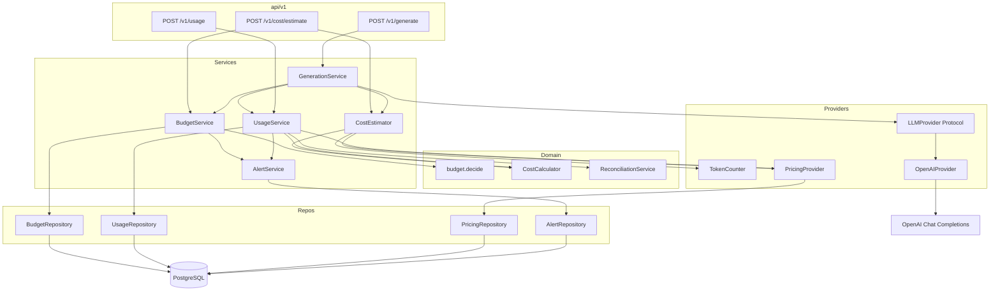
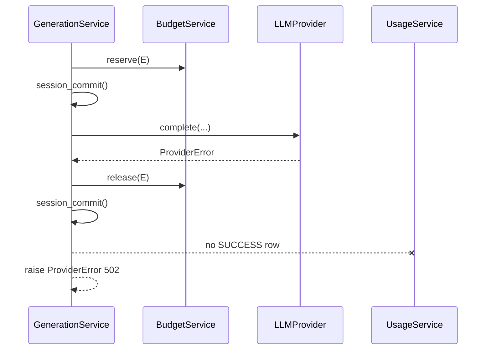
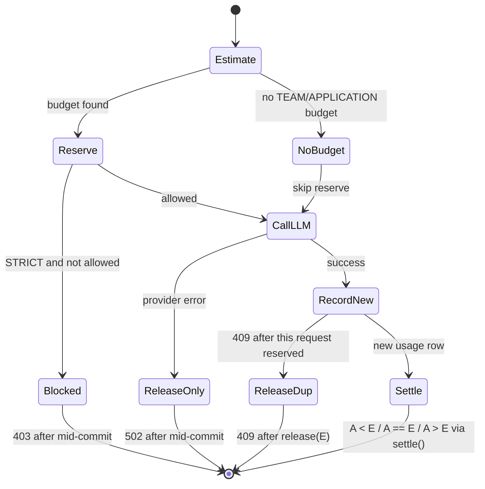

# Phase 14 + 15 — LLM Provider Integration and End-to-End Generation Flow

| Field | Value |
|-------|-------|
| **Author** | Grok Design (Phase 14+15) |
| **Date** | 2026-08-13 |
| **Status** | Approved |
| **Repo** | `/Users/pranjulyabajpai/src/genAI/token_cost_estimator` |
| **Parent PRD** | `# Project 02 — GenAI Token Cost Estimato.md` (Phase 14, Phase 15, FR-01–09, §22 estimate flow, §23 actual usage flow, §26 reservation pattern, §30 error model) |
| **Depends on** | Vertical slice; budget reserve/commit/release (PR #1); alert system (PR #2 / Phase 13) |
| **Scope choice** | Option B — one spec covering Phase 14 (LLMProvider + OpenAI adapter) and Phase 15 (`POST /v1/generate` FinOps loop) |

> **PRD ↔ code status mapping:** PRD narrative sometimes uses `REQUIRE_OVERRIDE` / Redis reservations / a client-driven “call LLM then POST /v1/usage” loop. This design follows **implemented** domain constants in `src/app/domain/budget.py` (`ALLOW` / `WARN` / `CRITICAL` / `BLOCK`, `STRICT` / `ADVISORY`) and the existing Postgres `FOR UPDATE` reservation in `BudgetService.reserve`. Phase 13 alert hooks stay on `reserve` and `UsageService.record` (persist+log only). No new alert types.

---

## Overview

Today the service can estimate cost, atomically **reserve** against a TEAM/APPLICATION budget, record **caller-supplied** usage, reconcile estimate vs actual, and emit Phase 13 alerts. It never dials an LLM. It never calls `BudgetService.commit` or `BudgetService.release` from any HTTP path. `POST /v1/cost/estimate` always `reserve`s when a budget exists, so every estimate permanently increments `budget_consumption.reserved_amount` — a leak, because nothing settles the reservation.

This spec closes the money loop on a single new command endpoint:

```text
tokenize → estimate → budget reserve → LLM call → actual usage → actual cost
→ reconcile → persist → commit/release reservation → existing alert hooks → response
```

Phase 14 introduces an `LLMProvider` Protocol and one official-SDK OpenAI adapter. Phase 15 adds `POST /v1/generate` as the **only** path that calls an LLM and the **only** path that reserves **and** settles. Estimate becomes evaluate-only (no mutation). The request DB transaction is committed after a successful reserve so `FOR UPDATE` is never held across OpenAI HTTP.

---

## Background & Motivation

### Current state

| Capability | Where it lives | Gap |
|------------|----------------|-----|
| Tokenize + price + Decimal cost | `CostEstimator.estimate` (`src/app/services/cost_estimator.py`) | Fine; reused as the preflight for generate |
| Estimate HTTP | `POST /v1/cost/estimate` in `src/app/api/v1/routes_cost.py` | **Always** calls `budget_service.reserve` when TEAM then APPLICATION budget exists; BLOCK does **not** raise — envelope returns 200 |
| Reserve / commit / release | `BudgetService` (`src/app/services/budget_service.py`) | `commit` / `release` exist and are service-tested in `tests/integration/test_budget.py`; **no HTTP path calls them** |
| Consumption math | `BudgetRepository.commit_amount` / `release_amount` | `commit_amount`: `reserved -= amount` (floor 0) then `committed += amount`; `release_amount`: `reserved -= amount` (floor 0) |
| Policy | `domain/budget.py::decide` | ADVISORY over-limit → `WARN` (`allowed` True); STRICT over-limit → `BLOCK` (`allowed` False). `reserve` increments reserved **only** when `decision.allowed` |
| Caller-supplied usage | `POST /v1/usage` → `UsageService.record` | Idempotent on `request_id`; anomaly alerts on new SUCCESS; does **not** touch budget counters |
| Alerts (Phase 13) | `BudgetService.reserve` + `UsageService.record` | Persist+log only; no new types needed |
| LLM providers | `src/app/providers/llm/__init__.py` is **empty** | No Protocol, no adapter, no `openai` runtime dependency (`httpx` is **dev-only** in `pyproject.toml`) |
| Error codes | `src/app/core/exceptions.py` | PRD §30 lists `BUDGET_EXCEEDED`, `BUDGET_RESERVATION_FAILED`, `PROVIDER_ERROR`. Code has `ErrorCode.PROVIDER_ERROR` as a string **only** — no `ProviderError` / `BudgetExceededError` classes |
| Session | `get_db_session` (`src/app/db/session.py`) | One `AsyncSession` per request; `commit()` on success, `rollback()` on **any** exception. Holding this across OpenAI HTTP holds a transaction (and any `FOR UPDATE`) open |

### Pain points

1. **Reserved leak on every estimate.** `routes_cost.py` lines 39–40 call `reserve` and never settle. `reserved_amount` grows until the period rolls. This is the live bug that makes estimate-then-generate unsafe.
2. **No provider call means the PRD §23 loop is incomplete.** Clients must call an LLM themselves and `POST /v1/usage`. The service cannot enforce “BLOCK before provider spend.”
3. **`commit` / `release` are dead on the HTTP surface.** Settlement math is implemented and unit-tested, but unused in production paths.
4. **A naive generate that reuses estimate’s reserve would double-reserve** if a client estimates first, then generates.
5. **A naive generate that keeps the request transaction open across OpenAI** would hold `budget_consumption` `FOR UPDATE` for up to `openai_timeout_seconds` (default 60s), serializing all other reserves on that period.

### Constraints carried forward

- Decimal-only money (`app.utils.money`); never `float` for cost.
- Services do not hold `AsyncSession`; repositories do (`BudgetService`, `UsageService`, `AlertService` pattern).
- FastAPI caches `get_db_session` per request, so `estimator_dep` / `budget_service_dep` / `usage_service_dep` already share one session.
- Phase 13: no new alert types; hooks stay on `reserve` and `UsageService.record` / `record_new` (anomaly on new SUCCESS insert). `evaluate` must **not** fire alerts. `commit` / `release` / `settle` still do not re-run `decide()`.
- No schema migrations (K11). No Redis. No auth. No streaming.
- `tests/conftest.py` uses a real Postgres test DB and an httpx ASGI client. CI must never call live OpenAI.

---

## Goals & Non-Goals

### Goals

1. Introduce `LLMProvider` + `LLMCompletion` and one OpenAI Chat Completions adapter using the official async SDK.
2. Add `POST /v1/generate` that owns the full FinOps lifecycle (estimate → reserve → provider → record → settle).
3. Make `POST /v1/cost/estimate` **evaluate-only**: same TEAM-then-APPLICATION lookup and `BudgetEnvelope`, **zero** reserved mutation, **zero** budget events, **zero** budget alerts.
4. Never hold a DB transaction or `FOR UPDATE` across the provider HTTP call.
5. STRICT `BLOCK` never calls the provider; ADVISORY over-limit still reserves and calls.
6. Idempotent generate on existing `usage_records.request_id` → 409, no second LLM call, no second reserve.
7. Reuse `usage_records`, `budget_consumption`, `budget_events`, `alerts`. Default `endpoint` to `"/v1/generate"`.
8. Never log or persist prompt/completion text.
9. Unit tests with `FakeLLMProvider` / mocked SDK; integration tests with dependency override. No live OpenAI in CI.

### Non-Goals (explicit)

| Out of scope | Why |
|--------------|-----|
| Streaming / SSE | K9 / K15 |
| `messages[]`, temperature, system prompt | K9 v1 is a single user `input` string |
| Multi-provider beyond OpenAI | K7 / K15; factory rejects unknown names |
| Storing completion text (new table/column) | K10 / K11 / K15; lost HTTP body is not recoverable as text |
| Reservation TTL reaper | Accepted leak-on-crash risk (K15) |
| `GET /v1/usage/{request_id}` | K10; list `GET /v1/usage` and filter |
| Consumption / remaining HTTP API | K18; generate envelope is reserve-time only |
| Changing Phase 13 alert rules or adding post-commit threshold alerts | Phase 13 closed |
| Making `POST /v1/usage` settle budgets | K1: generate is the only reserve+settle path; `/v1/usage` stays caller-supplied |
| Implementing `BUDGET_RESERVATION_FAILED` | DB failures stay `DATABASE_ERROR` via the existing SQLAlchemy handler |
| Redis, authN/authZ, Docker, CI pipeline, notification channels, ML anomaly, live billing | K15 |
| Fixing `estimator_dep`’s `get_token_counter("openai")` heuristic quirk | Estimate and generate must share the same tokenizer so preflight `E` matches `/v1/cost/estimate`. Separate follow-up. |

---

## Key Decisions

### K1 — One generation endpoint owns the money lifecycle

Add `POST /v1/generate`. It is the **only** path that calls an LLM and the **only** path that `reserve`s **and** settles (`BudgetService.settle`, K16). Existing `commit` / `release` remain for tests and as `settle`’s internals.

`POST /v1/usage` remains for clients that call an LLM themselves. It stays idempotent usage+anomaly only and does **not** reserve, commit, or release. Clients that mix “external LLM + `/v1/usage`” with a TEAM budget will not have that spend reserved/committed by this service (pre-existing gap; do not paper over it in v1).

### K2 — Estimate becomes evaluate-only (behavior change)

`POST /v1/cost/estimate` **stops** calling `BudgetService.reserve`. It still looks up the active budget (TEAM then APPLICATION, same as `routes_cost.py` lines 34–38) and returns a `BudgetEnvelope` from a **pure** `budget_policy.decide(...)` against current `committed + reserved` **without** incrementing reserved.

Rationale: today every estimate permanently leaks `reserved_amount`. Clients that estimate-then-generate would **double-reserve** if estimate kept reserving.

`BudgetService.evaluate(budget, amount) -> BudgetDecision`:

- Reads consumption via a **non-locking** `BudgetRepository.get_consumption(budget_id, period_key) -> BudgetConsumption | None` (new). No non-locking read exists today — only `lock_consumption` (`FOR UPDATE`).
- If no row: treat `committed = 0`, `reserved = 0`.
- Calls `budget_policy.decide(...)`.
- Does **not** `set_reserved`, does **not** write `budget_events`, does **not** fire alerts.
- Must not call `lock_consumption` (estimate is the p95 < 100 ms path from PRD NFR; it must not serialize generate’s reserve lock).

A slightly stale snapshot on evaluate is acceptable: evaluate is advisory. Generate’s `reserve` is the race-safe enforcement point.

Also add `BudgetService.find_applicable(*, team_id, application_id) -> Budget | None` that encodes the TEAM-then-APPLICATION loop so estimate and generate cannot drift.

Update `tests/integration/test_estimate_flow.py`: envelope assertions stay; add “estimate does not write `RESERVE`/`DECISION` events, does not change `reserved_amount`, and does not insert a `BUDGET_THRESHOLD` alert.” PR2 README notes the operator-visible break.

### K3 — Do not hold the request DB transaction across the provider HTTP call

After a successful **or** blocking reserve (any `reserve` that wrote events/alerts), `GenerationService` must `await session_commit()` so the reservation (or BLOCK `DECISION` + alert) is durable and `FOR UPDATE` is released **before** `LLMProvider.complete`.

After the provider returns, reuse the **same** `AsyncSession` for usage persist + settlement. Never call OpenAI inside an open `FOR UPDATE`.

This is mandatory because `get_db_session` rollbacks on **any** exception (including `BudgetExceededError` / `ProviderError`). Without a mid-commit, a 403/502 would erase the `DECISION`/`RESERVE`/`RELEASE` audit and Phase 13 alerts.

### K4 — Settlement math (exact)

Let `E` = estimated total cost reserved (`Estimation.total_cost` / `breakdown.total_cost`), `A` = `UsageRecord.actual_cost` from a **new** `UsageService.record_new` insert.

**Invariant:** always consume **this request’s `E`** from the shared `reserved` counter and always add **this request’s `A`** to `committed`. Never decrement reserved by `A` when `A > E` — that would steal other in-flight reservations (see K16).

| Outcome | Actions |
|---------|---------|
| No budget configured | Skip reserve / settle / release entirely (same as estimate today when no TEAM/APPLICATION budget). |
| Provider failure **before** usage persist | `release(E)` only; do **not** insert a SUCCESS usage row; `session_commit()`; raise `ProviderError`. |
| Concurrent 409 after this request reserved (K17) | `release(E)` only; do **not** settle/commit actual; `session_commit()`; re-raise `GenerationAlreadyRecordedError`. |
| Provider success and `reserved` is True | `record_new(...)` then **always** `settle(budget, reserved_amount=E, actual_amount=A, request_id=rid)`. Never call raw `commit(A)` from GenerationService. |
| STRICT BLOCK | `reserve` does not increment reserved (already true); mid-commit `DECISION`+alert; raise `BudgetExceededError`; **no** provider call. |

`settle` writes events (K16). Do not re-run `decide()` on settle. Do not fire new budget alerts on commit/release/settle (Phase 13 K3).

Existing `BudgetRepository.commit_amount` / `release_amount` **stay unchanged**. `settle` uses them for `A <= E` and uses new `apply_overage` for `A > E`.

### K5 — STRICT BLOCK never calls the provider

If a budget exists, `enforcement_mode=STRICT`, and `decision.allowed` is False:

1. Still **call** `reserve` (so the existing `DECISION` event + Phase 13 BLOCK alert fire; reserved is not incremented).
2. Mid-commit.
3. Do **not** call the LLM.
4. Raise `BudgetExceededError` (`ErrorCode.BUDGET_EXCEEDED`, HTTP **403**) with this **exact** message:

   `Budget exceeded for request_id='{rid}': status=BLOCK remaining_before={before} remaining_after={after}.`

   `{before}` / `{after}` are `BudgetDecision.remaining_before` / `remaining_after` rendered with `str(Decimal)` (no extra quantization).

ADVISORY over-limit is `WARN` (`allowed` True) and **does** reserve + call.

### K6 — LLMProvider abstraction

Path: `src/app/providers/llm/base.py`. Match tokenizer/pricing style: `typing.Protocol`, not ABC.

```python
from dataclasses import dataclass
from typing import Protocol

@dataclass(frozen=True)
class LLMCompletion:
    text: str
    prompt_tokens: int
    completion_tokens: int
    cached_prompt_tokens: int  # 0 if provider omitted
    model: str
    provider: str

class LLMProvider(Protocol):
    async def complete(
        self,
        *,
        model: str,
        prompt: str,
        max_output_tokens: int,
        request_id: str,
    ) -> LLMCompletion: ...
```

`GenerationService` depends only on this Protocol (plus a factory callable). Core services (`CostEstimator`, `BudgetService`, `UsageService`, `CostCalculator`) must **not** import the OpenAI SDK.

`LLMCompletion.prompt_tokens` is the **provider-reported** prompt total (OpenAI includes cached in `usage.prompt_tokens`). Billing split is GenerationService’s job (see Proposed Design).

### K7 — One adapter: OpenAI

`src/app/providers/llm/openai_provider.py` using official `openai.AsyncOpenAI`.

- API: Chat Completions, single user message = `prompt`.
- `max_tokens=max_output_tokens` (same integer used as estimate `expected_output_tokens`).
- Map `usage.prompt_tokens`, `usage.completion_tokens`, and cached tokens from `usage.prompt_tokens_details.cached_tokens` if present else 0.
- Timeouts via settings. `max_retries=0` so a reserved request fails fast and releases rather than retrying under the reservation.
- Construct the client **per call** with `async with AsyncOpenAI(...) as client:` around `chat.completions.create`. Do **not** construct at import time. Do **not** keep a process-global client in v1. Unit tests assert the mock is entered and exited (context manager).
- Translate **all** SDK/HTTP errors to `ProviderError` (`ErrorCode.PROVIDER_ERROR`, HTTP 502).
- Missing `usage` on a 200 → `ProviderError` (cannot price actuals).
- Unknown `provider` string at the factory → `ModelNotSupportedError` (422) — not a provider HTTP error.
- Add `openai>=1.40` to **runtime** `dependencies` in `pyproject.toml` (pulls `httpx` transitively; keep explicit `httpx` in the **dev** group for the ASGI test client).

### K8 — Factory and settings

`get_llm_provider(name: str) -> LLMProvider` in `src/app/providers/llm/__init__.py`. v1 only `"openai"` (case-sensitive, lowercase; reject others with `ModelNotSupportedError`).

New `Settings` fields (`APP_` prefix, `get_settings` remains `lru_cached`):

| Field | Env | Default | Notes |
|-------|-----|---------|-------|
| `openai_api_key` | `APP_OPENAI_API_KEY` | `None` | Optional at process start |
| `openai_base_url` | `APP_OPENAI_BASE_URL` | `None` | Optional; omit on client when unset |
| `openai_timeout_seconds` | `APP_OPENAI_TIMEOUT_SECONDS` | `60` | Passed to `AsyncOpenAI(timeout=...)` |
| `generate_enabled` | `APP_GENERATE_ENABLED` | **`False`** | Process restart required to flip. Production must set `APP_GENERATE_ENABLED=true` **and** `APP_OPENAI_API_KEY`. |

Missing API key when generate is **invoked** → `ProviderError` 502 with message `OpenAI API key is not configured (APP_OPENAI_API_KEY).` **Not** a startup crash (unit/integration tests without a key must still boot).

`generate_enabled=false` (the shipped default) → `GenerationDisabledError` (`ErrorCode.GENERATION_DISABLED`, HTTP **503**), checked in `GenerationService.generate` before idempotency/reserve/provider. Tests pass `generate_enabled=True` into the `GenerationService` constructor and/or override `generation_service_dep`; they must not rely on the process-wide Settings default.

Do not construct `AsyncOpenAI` at import time. Construct inside `complete()` after the key check, as a context manager (K7).

### K9 — Request/response contract

`POST /v1/generate` in new `src/app/api/v1/routes_generate.py`, mounted on `api_router` in `src/app/api/v1/router.py`. HTTP **200** on success (command, not `201` resource create).

No streaming. No `messages[]`. No temperature/system prompt in v1.

Request (Pydantic, mirror `EstimateRequest` where possible) — `src/app/schemas/generate.py`:

| Field | Type | Rules |
|-------|------|-------|
| `provider` | str | min 1, max 64 |
| `model` | str | min 1, max 128 |
| `input` | str | prompt; enforce `len(input) <= settings.max_prompt_chars` (default 200_000) via model validator |
| `max_output_tokens` | int | `ge=1`, `le=settings.max_expected_output_tokens` (default 1_000_000). Used as **both** Chat Completions `max_tokens` **and** estimate `expected_output_tokens` (conservative reservation). Generate validators are **stricter** than `EstimateRequest` (`expected_output_tokens` is `ge=0`, hardcoded `le=1_000_000`, no `max_prompt_chars`); a client can estimate a payload generate will 422. Do **not** align estimate this phase (follow-up only). |
| `application_id`, `team_id`, `user_id` | optional str | same max lengths as `UsageCreate` |
| `endpoint` | optional str | default `"/v1/generate"` when omitted (K11) |
| `request_id` | optional str | if omitted, `new_request_id()` (`req_` + 24 hex) |
| `correlation_id` | optional str | passed through to usage |

Response:

| Field | Source |
|-------|--------|
| `request_id`, `provider`, `model` | request / echo |
| `output` | `LLMCompletion.text` |
| estimated tokens + estimated costs | same breakdown as `EstimateResponse` (`estimated_input_tokens`, `estimated_output_tokens`, `estimated_input_cost`, `estimated_cached_input_cost`, `estimated_output_cost`, `estimated_total_cost`) |
| `actual_input_tokens`, `actual_cached_input_tokens`, `actual_output_tokens` | billed split (see below), matching `usage_records` |
| `actual_cost` | `UsageRecord.actual_cost` (`Money` string) |
| `variance_amount`, `variance_percent` | from `UsageRecord` / `ReconciliationService` (`SignedMoney`) |
| `currency`, `pricing_version` | from estimate/usage |
| `budget` | `BudgetEnvelope` from the **reserve-time** `BudgetDecision` (`decide(E)` after `reserve`); if `budget_decision` is `None`, ENABLED stub (`status="ENABLED"`, remainings `None`). **Not** post-settlement remaining (K18). |
| `status` | always `"SUCCESS"` on 200 |

`GenerationService.generate` returns this frozen dataclass (mapped by `GenerateResponse.from_result`):

```python
@dataclass(frozen=True)
class GenerationResult:
    request_id: str
    provider: str
    model: str
    output: str
    estimation: Estimation
    usage: UsageRecord
    budget_decision: BudgetDecision | None  # None → ENABLED stub envelope
```

### K10 — Idempotency

If `request_id` already exists in `usage_records` at the **start** of generate: **do not** call the LLM and **do not** reserve again. Return HTTP **409** with `ErrorCode.GENERATION_ALREADY_RECORDED`.

Do **not** persist completion text (no new table/column). Do **not** add `GET /v1/usage/{request_id}` this phase. Clients that lost the HTTP response can list `GET /v1/usage` and filter by `request_id` for money, but **not** the text. Document this in README.

`POST /v1/usage` keeps idempotent `UsageService.record` **unchanged**. Generate uses a new `record_new` (K17) so a concurrent or sequential second insert cannot silently return the existing row and then settle again.

A 5xx after reserve but **before** usage persist is **not** covered by 409 (no usage row). Retry with the same `request_id` will reserve again (possible double-reserve leak) and call the LLM again. Accepted; see Risks. Recommend client-supplied `request_id` and a **new** id after 5xx.

### K11 — No schema migrations

Reuse `usage_records`, `budget_consumption`, `budget_events`, `alerts`. Default `endpoint` to `"/v1/generate"` when omitted. `environment` on the usage row: `settings.environment`.

### K12 — Prompt privacy

Never log `input` or `output` text. Log `request_id`, provider, model, token counts, costs, budget status. Do not store prompts on `usage_records` (existing columns only). `src/app/core/logging.py` already states callers must not pass raw prompt text into log bindings.

### K13 — Testing

No live OpenAI in CI.

- Inject a `FakeLLMProvider` into `GenerationService` unit tests.
- Dependency-override the LLM factory **only** in `tests/integration/test_generate_flow.py` (not `conftest.py`).
- Unit-test settlement via `settle`: `A < E` → COMMIT A + RELEASE (E−A); `A == E` → COMMIT E only; `A > E` → `apply_overage` (reserved −= E, committed += A), one COMMIT A, no RELEASE. Overlapping reservations: G1 settles `A > E`, G2’s reserved `E2` remains intact (`used = A1 + E2`).
- Unit-test 409: existing row at start (no reserve); `record_new` after reserve → `release(E)` + 409 + no settle.
- Unit-test: release on provider failure; BLOCK; no-budget; `generate_enabled=False`; missing key.
- Integration-test: happy path writes usage + settle events; STRICT BLOCK is 403 and no usage row; provider raise → RELEASE event and no SUCCESS usage; estimate no longer writes RESERVE events or `BUDGET_THRESHOLD` alerts.

### K14 — Session ownership

Match existing services: **no** `AsyncSession` on `GenerationService`. Repositories stay on the child services. Inject an explicit commit callback from the route/deps so the service can mid-commit after reserve (and after release-on-failure).

Exact constructor (locked):

```python
from collections.abc import Awaitable, Callable

class GenerationService:
    def __init__(
        self,
        *,
        estimator: CostEstimator,
        budget_service: BudgetService,
        usage_service: UsageService,
        usage_repository: UsageRepository,
        get_llm: Callable[[str], LLMProvider],
        session_commit: Callable[[], Awaitable[None]],
        generate_enabled: bool,
        environment: str,
    ) -> None: ...
```

`usage_repository` is used only for the pre-flight `get_by_request_id` 409 check (same session as `UsageService`). Deps pass `session_commit=session.commit` only — **no** `_commit` wrapper.

Routes stay thin: validate + call `GenerationService.generate`.

### K15 — Out of scope

Streaming; multi-provider beyond OpenAI; Redis; authN/authZ; Docker/CI; notification channels; reservation TTL reaper (leak-on-crash is an accepted risk); storing completions; changing alert rules; ML anomaly; live billing; `GET /v1/usage/{request_id}`; consumption/remaining HTTP API; `max_completion_tokens` branching.

### K16 — `BudgetService.settle` (A>E must not steal other reservations)

Shared `budget_consumption.reserved_amount` is the sum of **all** in-flight `E`s. `commit_amount(A)` decrements reserved by `A`, not by this request’s `E`. When `A > E` while G2 still holds `E2`, `commit(A)` under-counts G2’s hold and lets a third request through the `FOR UPDATE` gate. The heuristic tokenizer (kept so estimate and generate share `E`) plus OpenAI `max_tokens` capping **output only** makes `A > E` a common happy path.

Locked API:

```python
async def settle(
    self,
    budget: Budget,
    *,
    reserved_amount: Decimal,
    actual_amount: Decimal,
    request_id: str | None,
) -> None:
    """Consume this request's E from reserved; add this request's A to committed."""
```

Semantics (one `lock_consumption` inside `settle`):

| Case | Repository calls | Events |
|------|------------------|--------|
| `A < E` | `commit_amount(A)` then `release_amount(E - A)` | `COMMIT` amount=A; `RELEASE` amount=(E−A) |
| `A == E` | `commit_amount(E)` only | `COMMIT` amount=E |
| `A > E` | **`apply_overage(row, reserved_consume=E, committed_add=A)`** — do **not** call `commit_amount(A)` | one `COMMIT` amount=A (actual spend). No fake RELEASE |

```python
async def apply_overage(
    self,
    row: BudgetConsumption,
    *,
    reserved_consume: Decimal,
    committed_add: Decimal,
) -> None:
    row.reserved_amount = max(row.reserved_amount - reserved_consume, Decimal("0"))
    row.committed_amount += committed_add
    await self._session.flush()
```

`GenerationService` after successful `record_new` always calls `settle(...)` when `reserved` is True — never raw `commit(A)` for the `A > E` case. Existing `commit` / `release` service methods remain for unit tests and as `settle`’s `A <= E` internals; their math is **not** changed.

### K17 — `UsageService.record_new` for generate

Same kwargs as `record`. Differences:

1. If `get_by_request_id` finds a row → raise `GenerationAlreadyRecordedError` (do **not** return the existing row).
2. On `IntegrityError` from unique `request_id` → raise `GenerationAlreadyRecordedError` (map after rollback of the failed INSERT via a savepoint so the outer session stays usable).

`POST /v1/usage` keeps `record` unchanged.

`GenerationService` wraps `record_new` in `try/except GenerationAlreadyRecordedError`: if this request reserved, `release(E)`, `session_commit()`, re-raise 409. **Do not settle/commit actual.** Sequential 409 (row exists at start) still happens **before** reserve.

`record_new` still fires the Phase 13 anomaly hook on a newly inserted SUCCESS row (same as `record` after a successful insert).

### K18 — No post-settlement remaining over HTTP

Generate’s `budget` envelope is the reserve-time `decide(E)` projection (`remaining_before` / `remaining_after` from that decision). `GET /v1/budgets/{id}` returns policy fields only (`BudgetOut`: limit, thresholds, window) — it does **not** expose committed/reserved/remaining. Do **not** add a consumption read API or a post-settlement field on `GenerateResponse` this phase. Clients that need live remaining must wait for a later phase.

---

## Proposed Design

### Architecture



`GenerationService` is the orchestrator. It does not import `openai`. The OpenAI SDK lives only in `openai_provider.py`.

### Sequence — happy path (`E > A`, budget present)

```mermaid
sequenceDiagram
  participant C as Client
  participant R as routes_generate
  participant G as GenerationService
  participant E as CostEstimator
  participant B as BudgetService
  participant DB as AsyncSession
  participant L as LLMProvider
  participant U as UsageService

  C->>R: POST /v1/generate
  R->>G: generate(...)
  G->>U: usage_repository.get_by_request_id
  U-->>G: None
  G->>E: estimate(input, expected_output=max_output_tokens)
  E-->>G: Estimation E
  G->>B: find_applicable(team, app)
  B-->>G: Budget
  G->>B: reserve(budget, E, request_id)
  B-->>G: BudgetDecision ALLOW/WARN/CRITICAL
  G->>DB: session_commit()
  Note over DB: UoW1 durable; FOR UPDATE released
  G->>L: complete(model, prompt, max_output_tokens, request_id)
  L-->>G: LLMCompletion
  G->>U: record_new(actual tokens, estimated_cost=E)
  U-->>G: UsageRecord A
  G->>B: settle(reserved_amount=E, actual_amount=A)
  G-->>R: GenerationResult
  Note over DB: get_db_session commits UoW2
  R-->>C: 200 GenerateResponse
```

### Sequence — STRICT BLOCK

```mermaid
sequenceDiagram
  participant C as Client
  participant G as GenerationService
  participant B as BudgetService
  participant L as LLMProvider

  G->>B: reserve(E)
  B-->>G: BLOCK allowed=false
  Note over B: reserved unchanged; DECISION event + BLOCK alert
  G->>G: session_commit()
  G--xL: not called
  G-->>C: 403 BUDGET_EXCEEDED
```

### Sequence — provider failure after reserve



### Settlement state machine



### BudgetService changes

`src/app/services/budget_service.py` — add `evaluate`, `find_applicable`, and `settle`. Do **not** change `reserve` / `commit` / `release` **math**. `settle` is the generate-facing API (K16).

```python
async def find_applicable(
    self, *, team_id: str | None, application_id: str | None
) -> Budget | None:
    for scope_type, scope_id in (("TEAM", team_id), ("APPLICATION", application_id)):
        if scope_id:
            budget = await self.find_for(scope_type, scope_id)
            if budget is not None:
                return budget
    return None

async def evaluate(self, budget: Budget, amount: Decimal) -> BudgetDecision:
    """Pure snapshot decision. No reserved mutation, no events, no alerts."""
    period_key = period_key_for(budget.period_type)
    row = await self._repository.get_consumption(budget.id, period_key)
    reserved = (row.reserved_amount if row is not None else Decimal("0")) or Decimal("0")
    committed = (row.committed_amount if row is not None else Decimal("0")) or Decimal("0")
    return budget_policy.decide(
        limit=budget.limit_amount,
        committed=committed,
        reserved=reserved,
        requested=amount,
        warning=budget.warning_threshold,
        critical=budget.critical_threshold,
        enforcement_mode=budget.enforcement_mode,
    )

async def settle(
    self,
    budget: Budget,
    *,
    reserved_amount: Decimal,
    actual_amount: Decimal,
    request_id: str | None,
) -> None:
    """Consume reserved_amount (E) from reserved; add actual_amount (A) to committed."""
    E = reserved_amount
    A = actual_amount
    period_key = period_key_for(budget.period_type)
    row = await self._repository.lock_consumption(budget.id, period_key)
    if A < E:
        await self._repository.commit_amount(row, A)
        await self._repository.add_event(
            budget_id=budget.id, event_type="COMMIT", period_key=period_key,
            amount=A, request_id=request_id,
        )
        leftover = E - A
        await self._repository.release_amount(row, leftover)
        await self._repository.add_event(
            budget_id=budget.id, event_type="RELEASE", period_key=period_key,
            amount=leftover, request_id=request_id,
        )
    elif A == E:
        await self._repository.commit_amount(row, E)
        await self._repository.add_event(
            budget_id=budget.id, event_type="COMMIT", period_key=period_key,
            amount=E, request_id=request_id,
        )
    else:
        await self._repository.apply_overage(
            row, reserved_consume=E, committed_add=A
        )
        await self._repository.add_event(
            budget_id=budget.id, event_type="COMMIT", period_key=period_key,
            amount=A, request_id=request_id,
        )
```

`src/app/repositories/budget_repository.py` — add:

```python
async def get_consumption(
    self, budget_id: int, period_key: str
) -> BudgetConsumption | None:
    stmt = select(BudgetConsumption).where(
        BudgetConsumption.budget_id == budget_id,
        BudgetConsumption.period_key == period_key,
    )
    return await self._session.scalar(stmt)

async def apply_overage(
    self,
    row: BudgetConsumption,
    *,
    reserved_consume: Decimal,
    committed_add: Decimal,
) -> None:
    row.reserved_amount = max(row.reserved_amount - reserved_consume, Decimal("0"))
    row.committed_amount += committed_add
    await self._session.flush()
```

`get_consumption`: no `FOR UPDATE`. Do not insert a zero row. `apply_overage` is only called from `settle` while the row is already locked.

### Estimate route (behavior change)

`src/app/api/v1/routes_cost.py` — replace `reserve` with `evaluate`. Keep envelope mapping identical.

```python
envelope = BudgetEnvelope()
budget = await budget_service.find_applicable(
    team_id=body.team_id, application_id=body.application_id
)
if budget is not None:
    decision = await budget_service.evaluate(budget, b.total_cost)
    envelope = BudgetEnvelope(
        status=decision.status,
        remaining_before_request=decision.remaining_before,
        remaining_after_estimate=decision.remaining_after,
    )
```

STRICT BLOCK on estimate still returns **200** + `budget.status="BLOCK"` (today’s contract). Only **generate** raises 403. This is intentional: estimate is a preflight calculator, not an enforcement gate.

### GenerationService algorithm

```python
async def generate(self, *, provider: str, model: str, input_text: str,
                   max_output_tokens: int, application_id: str | None,
                   team_id: str | None, user_id: str | None,
                   endpoint: str | None, request_id: str | None,
                   correlation_id: str | None) -> GenerationResult:
    if not self._generate_enabled:
        raise GenerationDisabledError("Generation is disabled (APP_GENERATE_ENABLED=false).")

    rid = request_id or new_request_id()
    ep = endpoint or "/v1/generate"

    existing = await self._usage_repository.get_by_request_id(rid)
    if existing is not None:
        raise GenerationAlreadyRecordedError(rid)

    estimation = await self._estimator.estimate(
        provider=provider,
        model=model,
        input_text=input_text,
        expected_output_tokens=max_output_tokens,
    )
    E = estimation.total_cost

    budget = await self._budget_service.find_applicable(
        team_id=team_id, application_id=application_id
    )
    decision = None
    reserved = False
    if budget is not None:
        decision = await self._budget_service.reserve(budget, E, request_id=rid)
        await self._session_commit()  # UoW1: RESERVE or DECISION (+ alerts)
        if not decision.allowed:
            raise BudgetExceededError(
                f"Budget exceeded for request_id='{rid}': status=BLOCK "
                f"remaining_before={decision.remaining_before} "
                f"remaining_after={decision.remaining_after}.",
                request_id=rid,
            )
        reserved = True

    try:
        llm = self._get_llm(provider)
        completion = await llm.complete(
            model=model,
            prompt=input_text,
            max_output_tokens=max_output_tokens,
            request_id=rid,
        )
    except AppError:
        if reserved:
            await self._budget_service.release(budget, E, request_id=rid)
            await self._session_commit()
        raise
    except Exception as exc:
        if reserved:
            await self._budget_service.release(budget, E, request_id=rid)
            await self._session_commit()
        raise ProviderError(f"Provider call failed: {exc}", request_id=rid) from exc

    cached = completion.cached_prompt_tokens
    uncached = max(completion.prompt_tokens - cached, 0)

    try:
        record = await self._usage_service.record_new(
            request_id=rid,
            correlation_id=correlation_id,
            provider=completion.provider,
            model=completion.model,
            application_id=application_id,
            team_id=team_id,
            user_id=user_id,
            endpoint=ep,
            environment=self._environment,
            estimated_input_tokens=estimation.input_tokens,
            estimated_output_tokens=estimation.output_tokens,
            estimated_cost=E,
            actual_input_tokens=uncached,
            cached_input_tokens=cached,
            actual_output_tokens=completion.completion_tokens,
            status="SUCCESS",
        )
    except GenerationAlreadyRecordedError:
        if reserved:
            await self._budget_service.release(budget, E, request_id=rid)
            await self._session_commit()
        raise

    A = record.actual_cost  # Decimal

    if reserved:
        await self._budget_service.settle(
            budget, reserved_amount=E, actual_amount=A, request_id=rid
        )

    return GenerationResult(
        request_id=rid,
        provider=completion.provider,
        model=completion.model,
        output=completion.text,
        estimation=estimation,
        usage=record,
        budget_decision=decision,
    )
```

`GenerationResult` (locked):

```python
@dataclass(frozen=True)
class GenerationResult:
    request_id: str
    provider: str
    model: str
    output: str
    estimation: Estimation
    usage: UsageRecord
    budget_decision: BudgetDecision | None  # None → ENABLED stub envelope
```

`GenerateResponse.from_result` maps:

- estimated_* from `result.estimation` / `estimation.breakdown`
- actual_* / variance_* / `actual_cost` / `pricing_version` / `status` from `result.usage`
- `output` from `result.output`
- `budget`: if `budget_decision is None` → `BudgetEnvelope()`; else `BudgetEnvelope(status=decision.status, remaining_before_request=decision.remaining_before, remaining_after_estimate=decision.remaining_after)`

`get_llm(provider)` is invoked **after** BLOCK is ruled out so a bad provider on a blocked budget still 403s (budget is the product gate). Unknown provider after ALLOW still 422 and must release `E` (the `except AppError` branch).

`ModelPricingNotFoundError` from `estimate()` happens **before** reserve — no leak.

### `UsageService.record_new`

Same signature as `record`. Sketch:

```python
async def record_new(self, **kwargs) -> UsageRecord:
    existing = await self._repository.get_by_request_id(kwargs["request_id"])
    if existing is not None:
        raise GenerationAlreadyRecordedError(kwargs["request_id"])
    try:
        async with self._repository.session_savepoint():  # begin_nested on the repo session
            return await self._insert_and_alert(**kwargs)  # same body as record after the idempotent return
    except IntegrityError as exc:
        raise GenerationAlreadyRecordedError(kwargs["request_id"]) from exc
```

Implement the savepoint on the repository (or `async with session.begin_nested()` inside `record_new` if the service is given no session — then add a thin `UsageRepository.add_new` that wraps `add` in `begin_nested` and lets `IntegrityError` propagate after the nested rollback). Locked: **unique violation must not poison the outer session**, so the INSERT runs inside `begin_nested()`. After `GenerationAlreadyRecordedError` the outer UoW can still `release(E)` + `session_commit()`.

Do **not** change `record`.

### Cached-token billing split (locked)

`CostCalculator.calculate` bills `input_tokens` at the input rate **plus** `cached_input_tokens` at the cached rate. `usage_records.actual_input_tokens` is therefore **uncached** billed input (same convention as `POST /v1/usage`).

OpenAI reports `usage.prompt_tokens` **including** cached tokens. Adapter stores raw numbers on `LLMCompletion`. GenerationService splits:

```text
cached   = completion.cached_prompt_tokens          # 0 if omitted
uncached = max(completion.prompt_tokens - cached, 0)
```

If we passed OpenAI `prompt_tokens` through unchanged **and** passed cached separately, cached tokens would be double-counted.

### OpenAI adapter

```python
class OpenAIProvider:
    def __init__(
        self,
        *,
        api_key: str | None,
        base_url: str | None,
        timeout_seconds: float,
    ) -> None:
        self._api_key = api_key
        self._base_url = base_url
        self._timeout_seconds = timeout_seconds

    async def complete(self, *, model: str, prompt: str,
                       max_output_tokens: int, request_id: str) -> LLMCompletion:
        if not self._api_key:
            raise ProviderError(
                "OpenAI API key is not configured (APP_OPENAI_API_KEY).",
                request_id=request_id,
            )
        kwargs: dict = {
            "api_key": self._api_key,
            "timeout": self._timeout_seconds,
            "max_retries": 0,
        }
        if self._base_url:
            kwargs["base_url"] = self._base_url
        try:
            async with AsyncOpenAI(**kwargs) as client:
                resp = await client.chat.completions.create(
                    model=model,
                    messages=[{"role": "user", "content": prompt}],
                    max_tokens=max_output_tokens,
                )
        except Exception as exc:
            raise ProviderError(
                f"OpenAI request failed: {exc}", request_id=request_id
            ) from exc

        choice = resp.choices[0] if resp.choices else None
        text = (choice.message.content if choice and choice.message else None) or ""
        usage = resp.usage
        if usage is None:
            raise ProviderError(
                "OpenAI response omitted usage; cannot price actuals.",
                request_id=request_id,
            )
        details = getattr(usage, "prompt_tokens_details", None)
        cached = int(getattr(details, "cached_tokens", 0) or 0) if details else 0
        return LLMCompletion(
            text=text,
            prompt_tokens=int(usage.prompt_tokens or 0),
            completion_tokens=int(usage.completion_tokens or 0),
            cached_prompt_tokens=cached,
            model=resp.model or model,
            provider="openai",
        )
```

Do not pass `request_id` as an OpenAI header in v1 (no extra coupling). It exists on the Protocol for tracing/log correlation inside the adapter **without logging prompt text**.

Factory:

```python
def get_llm_provider(name: str) -> LLMProvider:
    if name != "openai":
        raise ModelNotSupportedError(name, model="*")
    s = get_settings()
    return OpenAIProvider(
        api_key=s.openai_api_key,
        base_url=s.openai_base_url,
        timeout_seconds=s.openai_timeout_seconds,
    )
```

`ModelNotSupportedError` already formats `Model '{model}' is not supported by provider '{provider}'.` Using `model="*"` for an unknown provider is acceptable. GenerationService has the real model and may raise `ModelNotSupportedError(provider, model)` **before** calling the factory if we want a better message — lock: **factory** raises with the requested provider and `model="*"`; route/service may wrap with the real model. Prefer service-level:

```python
if provider != "openai":
    raise ModelNotSupportedError(provider, model)
completion = await self._get_llm(provider).complete(...)
```

Locked: `GenerationService` rejects `provider != "openai"` with `ModelNotSupportedError(provider, model)` **after** estimate/reserve (pricing for a hypothetical anthropic model would already 404 from `DatabasePricingProvider`). Seeded pricing is OpenAI-only today, so unknown providers fail at estimate with `MODEL_PRICING_NOT_FOUND` **before** reserve — which is correct. The explicit 422 is a backstop if someone seeds non-OpenAI pricing later.

### Exceptions

Add to `src/app/core/exceptions.py`:

```python
class ErrorCode(str):
    # existing...
    BUDGET_EXCEEDED = "BUDGET_EXCEEDED"
    PROVIDER_ERROR = "PROVIDER_ERROR"          # already present
    GENERATION_DISABLED = "GENERATION_DISABLED"
    GENERATION_ALREADY_RECORDED = "GENERATION_ALREADY_RECORDED"

class BudgetExceededError(AppError):
    code = ErrorCode.BUDGET_EXCEEDED
    status_code = 403

class ProviderError(AppError):
    code = ErrorCode.PROVIDER_ERROR
    status_code = 502

class GenerationDisabledError(AppError):
    code = ErrorCode.GENERATION_DISABLED
    status_code = 503

class GenerationAlreadyRecordedError(AppError):
    code = ErrorCode.GENERATION_ALREADY_RECORDED
    status_code = 409

    def __init__(self, request_id: str):
        super().__init__(
            f"Generation already recorded for request_id='{request_id}'. "
            "Completion text is not stored; list GET /v1/usage and filter by request_id for money.",
            request_id=request_id,
        )
```

Do **not** add `BUDGET_RESERVATION_FAILED`. Reserve I/O failures remain `DATABASE_ERROR` (500) via `register_exception_handlers`’s `SQLAlchemyError` handler.

### AppError `request_id` in the envelope

Today `handlers._app_error` ignores `exc.request_id` and uses `X-Request-ID` or a random id (`src/app/api/handlers.py` lines 21–33). Generate’s client-supplied `request_id` would not appear on 403/409/502.

Locked small fix: prefer `exc.request_id` when set.

```python
def _request_id(request: Request, exc: AppError | None = None) -> str:
    if exc is not None and exc.request_id:
        return exc.request_id
    return request.headers.get("X-Request-ID") or f"req_{uuid.uuid4().hex[:16]}"
```

### Dependencies

`src/app/api/dependencies.py` — add factory + service deps. FastAPI caches `get_db_session` per request, so the same session is shared.

```python
from collections.abc import Callable
from app.providers.llm import get_llm_provider
from app.providers.llm.base import LLMProvider
from app.services.generation_service import GenerationService

LLMFactory = Callable[[str], LLMProvider]

def llm_factory_dep() -> LLMFactory:
    return get_llm_provider

async def generation_service_dep(
    session: AsyncSession = Depends(get_db_session),
    estimator: CostEstimator = Depends(estimator_dep),
    budget_service: BudgetService = Depends(budget_service_dep),
    usage_service: UsageService = Depends(usage_service_dep),
    get_llm: LLMFactory = Depends(llm_factory_dep),
) -> GenerationService:
    settings = get_settings()
    return GenerationService(
        estimator=estimator,
        budget_service=budget_service,
        usage_service=usage_service,
        usage_repository=UsageRepository(session),
        get_llm=get_llm,
        session_commit=session.commit,
        generate_enabled=settings.generate_enabled,
        environment=settings.environment,
    )
```

`session_commit=session.commit` (bound method) only — no wrapper. After mid-commit, `expire_on_commit=False` (already set on `AsyncSessionLocal`) keeps the `Budget` ORM instance usable for later `settle` / `release`.

### Route

```python
# src/app/api/v1/routes_generate.py
router = APIRouter(tags=["generate"])

@router.post("/generate", response_model=GenerateResponse)
async def generate(
    body: GenerateRequest,
    service: GenerationService = Depends(generation_service_dep),
) -> GenerateResponse:
    result = await service.generate(
        provider=body.provider,
        model=body.model,
        input_text=body.input,
        max_output_tokens=body.max_output_tokens,
        application_id=body.application_id,
        team_id=body.team_id,
        user_id=body.user_id,
        endpoint=body.endpoint,
        request_id=body.request_id,
        correlation_id=body.correlation_id,
    )
    return GenerateResponse.from_result(result)
```

Mount: `api_router.include_router(routes_generate.router)` in `src/app/api/v1/router.py`.

### Schemas

`src/app/schemas/generate.py` reuses `BudgetEnvelope`, `Money`, `SignedMoney`.

`GenerateRequest.input` validator calls `get_settings().max_prompt_chars`. `max_output_tokens` validator calls `get_settings().max_expected_output_tokens`. Tests that mutate Settings must `get_settings.cache_clear()`.

`GenerateResponse.from_result` is a convenience constructor; a module-level mapper in the route is also fine. Keep money as Decimal strings (`Money` / `SignedMoney`).

### Mid-commit vs `get_db_session` rollback (correctness note)

```
UoW1: reserve (or BLOCK DECISION) → session_commit()     # durable
provider HTTP                                              # no DB lock
UoW2: record_new + settle(E, A)
      OR release(E) on provider failure / duplicate 409 → session_commit()
get_db_session: commit empty leftover txn on 200
                rollback UoW2 only if an exception escapes after UoW1
```

A later exception rollbacks **only** the second unit of work. UoW1 stays. Correct (K3 / Risks).

### Known tokenizer quirk (do not change)

`estimator_dep` injects `get_token_counter("openai")`. `get_token_counter` treats its argument as a **tiktoken model name**, so `"openai"` misses and returns `HeuristicTokenCounter` (~4 chars/token). Generate **must** keep using the same `CostEstimator` so `/v1/cost/estimate` and `/v1/generate` produce the same `E` for the same prompt. Fixing routing is a later, explicit change with its own test updates.

### POST /v1/usage coexistence

Still valid for external LLM callers. Does not participate in K1 settlement. Docs must say: if you need BLOCK-before-spend and reserved/committed counters, use `POST /v1/generate`; if you call the LLM yourself, use estimate (evaluate-only) + your LLM + `POST /v1/usage` (ledger only).

---

## API / Interface Changes

### New: `POST /v1/generate`

Request:

```json
{
  "provider": "openai",
  "model": "gpt-4o",
  "input": "Explain Decimal money math",
  "max_output_tokens": 200,
  "team_id": "platform-team",
  "application_id": "finops-api",
  "user_id": "u_123",
  "endpoint": "/v1/generate",
  "request_id": "req_client_supplied",
  "correlation_id": "corr_abc"
}
```

Response `200`:

```json
{
  "request_id": "req_client_supplied",
  "provider": "openai",
  "model": "gpt-4o",
  "output": "...",
  "estimated_input_tokens": 8,
  "estimated_output_tokens": 200,
  "estimated_input_cost": "0.00002",
  "estimated_cached_input_cost": "0",
  "estimated_output_cost": "0.002",
  "estimated_total_cost": "0.00202",
  "actual_input_tokens": 10,
  "actual_cached_input_tokens": 0,
  "actual_output_tokens": 80,
  "actual_cost": "0.000825",
  "variance_amount": "-0.001195",
  "variance_percent": "-59.158...",
  "currency": "USD",
  "pricing_version": 1,
  "budget": {
    "status": "ALLOW",
    "remaining_before_request": "100.00",
    "remaining_after_estimate": "99.99798"
  },
  "status": "SUCCESS"
}
```

`budget.remaining_after_estimate` is the **reserve-time projection** (`remaining_after` from `decide` using `E`), not post-settlement remaining. Name stays for envelope compatibility with `EstimateResponse`. **Post-settlement remaining is not exposed over HTTP in v1** (K18). `GET /v1/budgets/{id}` returns policy fields only — do not tell clients to read remaining from it. Do not add a consumption API this phase.

### Changed: `POST /v1/cost/estimate`

| Before | After |
|--------|-------|
| Looks up TEAM then APPLICATION budget | Same, via `find_applicable` |
| `reserve(E)` — increments reserved if allowed; writes `RESERVE`/`DECISION`; fires alerts | `evaluate(E)` — no writes |
| BLOCK returns 200 + envelope | Unchanged (still 200) |
| No budget → `BudgetEnvelope(status="ENABLED")` | Unchanged |

**Breaking for operators** who treated estimate as a reservation. That behavior was a leak and is not a supported contract.

### Errors (generate)

| Code | HTTP | When |
|------|------|------|
| `VALIDATION_ERROR` | 422 | Pydantic / prompt too long / `max_output_tokens` out of range |
| `MODEL_PRICING_NOT_FOUND` | 404 | No effective price (existing) |
| `MODEL_NOT_SUPPORTED` | 422 | Unknown provider string |
| `BUDGET_EXCEEDED` | 403 | STRICT BLOCK |
| `GENERATION_ALREADY_RECORDED` | 409 | `usage_records.request_id` exists (pre-reserve lookup **or** `record_new` unique race) |
| `GENERATION_DISABLED` | 503 | `APP_GENERATE_ENABLED=false` |
| `PROVIDER_ERROR` | 502 | Missing key, SDK/HTTP failure, omitted usage |
| `DATABASE_ERROR` | 500 | SQLAlchemy |
| `INTERNAL_ERROR` | 500 | Uncaught |

Envelope unchanged: `{"error":{"code","message","request_id"}}`.

### Unchanged

- `POST /v1/usage` (still `record`, idempotent), aggregations, budgets CRUD, alerts list/ack, health.
- `BudgetService.reserve` / `commit` / `release` **math** (new `settle` / `evaluate` / `find_applicable` only).
- Phase 13 alert types and dedupe keys. No `GET /v1/usage/{request_id}`.

---

## Data Model Changes

**None.** No Alembic revision.

| Table | How generate uses it |
|-------|----------------------|
| `usage_records` | One SUCCESS row per successful generate; unique `request_id` is the 409 gate (`record_new`) |
| `budget_consumption` | `reserve` increments reserved; `settle` consumes **E** from reserved and adds **A** to committed (`commit_amount`/`release_amount` or `apply_overage`) |
| `budget_events` | `RESERVE` or `DECISION`; then settle events (`COMMIT` A and optional leftover `RELEASE`; or one `COMMIT` A on overage); or `RELEASE` of full `E` on provider failure / duplicate 409 after reserve |
| `alerts` | Existing hooks only: threshold on `reserve` non-ALLOW; anomaly on new SUCCESS `record` / `record_new` |
| `model_pricing` | Read via `PricingProvider` for estimate and actual |

Default `endpoint="/v1/generate"`. No prompt/output columns.

---

## File Map

### Create

| Path | Role |
|------|------|
| `src/app/providers/llm/base.py` | `LLMCompletion`, `LLMProvider` Protocol |
| `src/app/providers/llm/openai_provider.py` | `OpenAIProvider` |
| `src/app/providers/llm/__init__.py` | `get_llm_provider` (file is currently empty) |
| `src/app/services/generation_service.py` | Orchestrator |
| `src/app/api/v1/routes_generate.py` | `POST /v1/generate` |
| `src/app/schemas/generate.py` | `GenerateRequest` / `GenerateResponse` |
| `tests/fakes/llm.py` | `FakeLLMProvider` |
| `tests/unit/test_openai_provider.py` | Mocked SDK |
| `tests/unit/test_generation_service.py` | Settlement branches |
| `tests/integration/test_generate_flow.py` | HTTP + DB events |

### Modify

| Path | Change |
|------|--------|
| `src/app/core/config.py` | `openai_api_key`, `openai_base_url`, `openai_timeout_seconds`, `generate_enabled` |
| `src/app/core/exceptions.py` | New codes + exception classes |
| `src/app/api/handlers.py` | Prefer `exc.request_id` |
| `src/app/api/dependencies.py` | `llm_factory_dep`, `generation_service_dep` |
| `src/app/api/v1/router.py` | Include generate router |
| `src/app/api/v1/routes_cost.py` | `evaluate` instead of `reserve` |
| `src/app/services/budget_service.py` | `evaluate`, `find_applicable`, `settle` |
| `src/app/repositories/budget_repository.py` | `get_consumption`, `apply_overage` |
| `src/app/services/usage_service.py` | add `record_new`; **do not** change `record` |
| `pyproject.toml` | runtime `openai>=1.40` |
| `README.md` | **PR2:** estimate no longer reserves/alerts/events. **PR3:** generate endpoint, env (`APP_GENERATE_ENABLED` default false), 409 list-and-filter caveat, roadmap |
| `tests/integration/test_estimate_flow.py` | No RESERVE leak; no `BUDGET_THRESHOLD` alert; evaluate envelope still ALLOW |

### Do not touch

- `migrations/` (no schema change)
- `src/app/domain/budget.py`, `src/app/domain/alerts.py` policy
- `BudgetService.reserve` / `commit` / `release` **math** (add `settle` + repo `apply_overage` only)
- `UsageService.record` signature and idempotent behavior
- `tests/conftest.py` (no global LLM factory override)
- Alert service / Phase 13 tests (except they keep passing because generate still uses `reserve`)

---

## Alternatives Considered

### A1 — Keep reserving on estimate

**Pros:** No behavior change; generate could “assume” a reservation exists.  
**Cons:** Permanent reserved leak (live bug). Estimate-then-generate double-reserves. Estimate is a calculator, not a hold.  
**Rejected.** K2.

### A2 — Two-step client protocol (`reservation_id` on estimate, generate consumes it)

**Pros:** Explicit holds; generate would not re-estimate.  
**Cons:** New persistence, TTL, orphaned holds, extra API surface. Clients that only generate would still need a reserve step.  
**Rejected** for v1. Generate is self-contained. Estimate is evaluate-only.

### A3 — Hold `get_db_session` transaction across OpenAI

**Pros:** Single UoW; crash rolls back reserve automatically.  
**Cons:** `FOR UPDATE` held for up to 60s; all other reserves on that period block; connection pool exhaustion; contradicts K3. Crash-rollback only works if the process dies **before** commit — mid-commit is required anyway for 403/502 audit.  
**Rejected.**

### A4 — Raw `httpx` instead of official `openai` SDK

**Pros:** One less direct dependency; `httpx` already in dev.  
**Cons:** Manual request/usage mapping, version drift, retries/timeouts reinvented. PRD wants a provider adapter, not a hand-rolled client. Official SDK is the adapter’s job; core still does not import it.  
**Rejected.** K7.

### A5 — Put `AsyncSession` on `GenerationService`

**Pros:** Direct `await session.commit()`.  
**Cons:** Breaks the “services never hold a session” pattern (Phase 13 K10, `BudgetService` / `UsageService`). Harder to unit-test.  
**Rejected.** K14: `session_commit` callback.

### A6 — Mid-commit usage **before** settlement

**Pros:** 409 would fire if settlement failed after persist; retry would not re-call the LLM.  
**Cons:** Usage row durable with reserved still at `E` (inconsistent money vs ledger until a repair job).  
**Rejected** for v1: keep usage + settlement in one UoW so ledger and counters stay atomic. Accept “UoW2 fail → leak + retry re-calls LLM” (Risks). Client-supplied `request_id` + new id after 5xx is the mitigation.

### A7 — Stream and/or `messages[]` in v1

**Pros:** Closer to production chat APIs.  
**Cons:** Streaming breaks the simple reserve→actual settle (usage arrives in chunks); `messages[]` needs tokenization of a conversation, not a string.  
**Rejected.** K9 / K15.

### A8 — `commit(A)` when `A > E` (shared-counter steal)

**Pros:** Reuses `commit_amount` with no new primitive.  
**Cons:** Decrements reserved by `A` instead of this request’s `E`, stealing G2’s hold. Heuristic tokenizer + output-only `max_tokens` makes `A > E` common.  
**Rejected.** K16: `settle` + `apply_overage(reserved_consume=E, committed_add=A)`.

### A9 — `GET /v1/usage/{request_id}` or consumption HTTP this phase

**Pros:** Makes 409 recovery and post-settle remaining first-class.  
**Cons:** Extra routes, extra tests, not required to close the generate loop.  
**Rejected.** K10 / K18. List-and-filter; no remaining HTTP.

### A10 — Process-global `AsyncOpenAI` client

**Pros:** Connection reuse under generate QPS.  
**Cons:** Lifecycle/shutdown hooks, import-time or first-request construction races, harder to unit-test close.  
**Rejected** for v1. Per-call `async with AsyncOpenAI(...) as client:` (K7). Revisit if QPS warrants it.

---

## Security & Privacy Considerations

| Threat | Severity | Handling |
|--------|----------|----------|
| Prompt/completion in logs | High | K12; never bind `input`/`output` in structlog. `logging.py` already forbids it. |
| Prompt stored in DB | High | No new columns; `usage_records` has no prompt field (K11). |
| API key in logs / repo | High | `APP_OPENAI_API_KEY` via Settings; never log settings dump of the key. Missing key is a 502 message that names the **env var**, not the secret. |
| Unauthenticated generate spends real money | High (accepted until Phase 17) | Auth is K15. **Default `generate_enabled=False`** so `/v1/generate` is 503 until an operator sets `APP_GENERATE_ENABLED=true` **and** `APP_OPENAI_API_KEY`. |
| Prompt injection / oversized input | Medium | `max_prompt_chars` (default 200k); `max_output_tokens` capped by Settings. |
| SSRF via `openai_base_url` | Medium | Operator-controlled env only; not a request field. |
| Budget bypass via `/v1/usage` | Low (pre-existing) | Documented; K1 does not make `/v1/usage` an enforcement path. |
| Budget bypass via estimate | N/A | Estimate no longer reserves and never blocked HTTP; generate is the gate. |

No authN/authZ in this phase. Treat `/v1/generate` as a trusted-network sidecar **after** an explicit enable. Fresh deploys do not spend until both env vars are set.

---

## Observability

Phase 16 owns metrics/tracing. This phase adds **structured logs only**, no new metrics backend.

Log events (no prompt/output bindings):

| Event | When | Bindings |
|-------|------|----------|
| `generate_started` | after request_id resolved | `request_id`, `provider`, `model`, `max_output_tokens`, `team_id`, `application_id` |
| `generate_duplicate` | 409 path | `request_id` |
| `generate_blocked` | STRICT BLOCK | `request_id`, `budget_id`, `status`, `estimated_cost` |
| `generate_reserved` | after UoW1 | `request_id`, `budget_id`, `status`, `estimated_cost` |
| `generate_provider_ok` | after complete | `request_id`, `prompt_tokens`, `cached_prompt_tokens`, `completion_tokens` |
| `generate_provider_failed` | adapter/service catch | `request_id`, `error_type` (not raw prompt) |
| `generate_settled` | after `settle` | `request_id`, `estimated_cost`, `actual_cost`, `leftover` (`max(E-A, 0)`) |

Use `get_logger("app.generate")`. Phase 13 `alert_created` / `alert_emit_failed` unchanged.

Latency (targets, not SLOs enforced in code):

| Path | Target |
|------|--------|
| `POST /v1/cost/estimate` | p95 < 100 ms excluding network (PRD NFR). Evaluate is a point read; no lock. |
| `POST /v1/generate` local work | Reserve + 1 commit + record + settle: typically < 50 ms on local Postgres. |
| Provider | Bounded by `APP_OPENAI_TIMEOUT_SECONDS` (60). Dominates p95. |

Load: generate QPS ≈ client LLM QPS (1:1). Estimate may be chatty; it no longer contends on `FOR UPDATE`.

Alerting: no new alert types. Existing budget threshold alerts fire from generate’s `reserve`. Anomaly alerts fire from generate’s `record_new` on new SUCCESS. Estimate **must not** create `BUDGET_THRESHOLD` rows.

---

## Rollout Plan

1. **PR1** — adapter + settings + exceptions. Ship with `generate_enabled` default **`False`**. No HTTP generate yet. Missing key is harmless at boot.
2. **PR2** — estimate evaluate-only. Deploy independently. **Behavior change:** reserved leak stops; estimate no longer creates `RESERVE` events or budget alerts. **README (or short operator note) lands in this PR.** Operators watching `budget_events` from estimate traffic will see volume drop to zero on that path — expected.
3. **PR3** — `POST /v1/generate`. Production must set **`APP_GENERATE_ENABLED=true` and `APP_OPENAI_API_KEY`**. Default remains 503. Kill switch: unset/false → 503 without process-unsafe state.
4. **Rollback:** revert PR3 (endpoint gone) or flip `generate_enabled` back to false. PR2 rollback would restore estimate leaking reserves — do **not** roll back PR2 without a reason. Adapter-only PR1 is idle if unused.

Feature flags: `APP_GENERATE_ENABLED` only. No per-tenant flag.

---

## Risks

| Risk | Severity | Mitigation |
|------|----------|------------|
| Process crash after UoW1 reserve, before settlement | **Medium** | `reserved_amount` leaks until the period rolls (`MONTHLY`/`DAILY` new `period_key`). Document. Optional later reaper. **Do not build reaper now** (K15). |
| LLM success + UoW2 (usage+settle) failure | **Medium** | Client sees 5xx; money spent at OpenAI; no usage row; retry same `request_id` **re-calls LLM** and **re-reserves** (double reserve). Mitigation: 409 only when usage exists; **recommend client-supplied `request_id` and a new id after 5xx**. Do not mid-commit usage before settle (A6). |
| Concurrent same `request_id` after both reserved | **Medium** | Both call LLM; loser of unique insert gets 409 from `record_new`, `release(E)`, no settle (K17). Winner settles once. Extra provider spend is accepted. |
| `commit(A)` when `A > E` | **High** if unimplemented | K16 `settle` / `apply_overage`. Unit-test overlapping reservations. |
| Mid-commit then later exception | **Low** | `get_db_session` rollbacks **UoW2 only**; UoW1 stays. Correct. |
| Estimate clients that assumed a hold | **Low** | Document breaking change in **PR2 README**. Generate is the hold. |
| Unauthenticated spend | **High** (accepted until auth) | Default `generate_enabled=False`; enable only with key. Phase 17 auth. |
| Seeded/default model rejects `max_tokens` | **Low** | v1 uses Chat Completions `max_tokens` (seeded models are gpt-4o family). If a model rejects it, SDK 400 → existing `ProviderError` 502. **No** `max_completion_tokens` branching in v1. |
| OpenAI `prompt_tokens` includes cached; naive pass-through double-counts | **High** if mishandled | Locked split in GenerationService. Unit-test cached > 0. |
| `get_settings` lru cache hides env flips in-process | **Low** | Same as Phase 13 `alerts_enabled`; requires restart. Tests `cache_clear()`. |
| STRICT BLOCK without mid-commit would lose DECISION+alert | **High** if unimplemented | K3: mid-commit after every `reserve`, including BLOCK. |
| Provider failure without mid-commit after `release` would rollback the release | **High** if unimplemented | `release(E)` then `session_commit()` then raise. |
| Fake provider forgotten in CI | **High** | Override `llm_factory_dep` **only** in `tests/integration/test_generate_flow.py`; unit tests never construct a real client. No `conftest.py` override. |

---

## Testing Plan

### Fake

`tests/fakes/llm.py`:

```python
@dataclass
class FakeLLMProvider:
    completion: LLMCompletion | None = None
    error: Exception | None = None
    calls: list[dict] = field(default_factory=list)

    async def complete(self, **kwargs) -> LLMCompletion:
        self.calls.append(kwargs)
        if self.error:
            raise self.error
        return self.completion or LLMCompletion(
            text="ok",
            prompt_tokens=10,
            completion_tokens=5,
            cached_prompt_tokens=0,
            model=kwargs["model"],
            provider="openai",
        )
```

### Unit — `tests/unit/test_openai_provider.py`

- Maps `usage.prompt_tokens` / `completion_tokens` / `prompt_tokens_details.cached_tokens`.
- Missing details → cached 0.
- Missing usage → `ProviderError`.
- Missing API key → `ProviderError` (no SDK call).
- SDK exception → `ProviderError` 502.
- **Context manager:** mock `AsyncOpenAI` so `__aenter__` / `__aexit__` (or the instance used as `async with`) are asserted entered and exited even on SDK error.
- Does not log prompt (assert mock logger calls if we inject a logger; otherwise code review + no `prompt` in exception messages beyond OpenAI’s own — do not include `prompt` in our `ProviderError` message).

Mock `AsyncOpenAI` with `unittest.mock.patch` on `app.providers.llm.openai_provider.AsyncOpenAI`.

### Unit — `tests/unit/test_generation_service.py`

Construct `GenerationService` with fakes (in-memory/stub estimator, stub budget, stub usage). Cover:

| Case | Expect |
|------|--------|
| Provider raise | `release(E)` called; no `record_new`; `ProviderError` |
| Success `A < E` | `record_new`; `settle` → COMMIT A + RELEASE (E−A) |
| Success `A == E` | `record_new`; `settle` → COMMIT E only |
| Success `A > E` | `record_new`; `settle` → `apply_overage(E, A)`; one COMMIT A; **no** RELEASE |
| Overlap: G1 `A1 > E1`, G2 still reserved `E2` | after G1 settle: `reserved == E2`, `committed == A1` (`used = A1 + E2`) |
| STRICT BLOCK | `reserve` called; no `complete`; exact 403 message; no `record_new` |
| No budget | no reserve/settle/release; still `complete` + `record_new` |
| Existing `request_id` at start | 409; no reserve; no complete |
| `record_new` 409 **after** this request reserved | `release(E)`; no `settle`; 409 |
| `generate_enabled=False` | 503 class; no estimate |
| Unknown provider after seeded pricing | 422; release if reserved |

### Integration — `tests/integration/test_generate_flow.py`

Use real Postgres + ASGI client. Override `llm_factory_dep` to a `FakeLLMProvider` **in this module only** (not `conftest.py`). Construct `GenerationService` / dep with `generate_enabled=True`. Seed pricing (and budget when needed) like `test_estimate_flow.py`.

| Case | Assert |
|------|--------|
| Happy path, budget, `A < E` | 200; `usage_records` SUCCESS; events `RESERVE`, `COMMIT` A, `RELEASE` (E−A); reserved back near 0; committed `== A` |
| Happy path `A > E` (fake token counts priced above E) | reserved decreased by **E** not A; committed `== A`; one COMMIT A; no leftover RELEASE |
| STRICT over-limit | 403 `BUDGET_EXCEEDED` with locked message; **no** usage row; `DECISION` event; **no** provider call (`fake.calls == []`); reserved unchanged |
| ADVISORY over-limit | 200; `RESERVE` happened; provider called |
| Fake raises `ProviderError` | 502; `RESERVE` + `RELEASE(E)`; no SUCCESS usage |
| Repeat `request_id` after success | 409; `fake.calls` still 1 |
| Concurrent / second `record_new` same id after reserve | service-level: `release(E)` + 409 + no settle. HTTP overlap optional; minimum is the unit test above |
| No budget | 200; no `budget_events`; usage row present |
| Default `generate_enabled` | process default False → 503 unless test override |

At minimum for the duplicate-after-reserve path: a **service-level** test that reserves, then makes `record_new` raise `GenerationAlreadyRecordedError` (stub or pre-insert), and asserts `release(E)` + no `settle`.

### Integration — `tests/integration/test_estimate_flow.py` updates

- Keep `test_estimate_with_budget_envelope` ALLOW + remaining math.
- Add: after estimate with `team_id`, `budget_events` count is 0; `budget_consumption.reserved_amount` is 0 or row absent; **no `BUDGET_THRESHOLD` alert row**.
- Confirm BLOCK estimate (tiny limit, large `expected_output_tokens`) still **200** with `budget.status == "BLOCK"` and no reserved increment and no alert.

### Phase 13 tests

`test_alert_hooks.py` calls `BudgetService.reserve` directly — still valid. No change required. Generate integration may optionally assert a BLOCK alert row exists (same hook).

### CI rule

No test constructs `OpenAIProvider.complete` without a mock. No test sets a real `APP_OPENAI_API_KEY` as a requirement. `conftest.py` must not import `openai` at collection time in a way that requires a key, and must **not** register a global LLM factory override.

---

## Open Questions

None — all product decisions locked above (including A>E `settle` as K16, `record_new` as K17, no consumption HTTP as K18, `generate_enabled` default False, `async with` client lifecycle, 409 list-and-filter, locked `GenerationResult` and 403 copy).

---

## References

- `# Project 02 — GenAI Token Cost Estimato.md` — Phase 14–15, FR-01–09, §22–23, §26 reservation, §30 errors
- `docs/superpowers/specs/2026-08-10-token-cost-estimator-vertical-slice.md`
- `docs/superpowers/specs/2026-08-12-phase-13-alert-system-design.md` (do not reopen)
- `src/app/api/v1/routes_cost.py` — current estimate+reserve
- `src/app/services/budget_service.py` — `reserve` / `commit` / `release` (add `settle` / `evaluate`)
- `src/app/repositories/budget_repository.py` — `commit_amount` / `release_amount` (add `apply_overage` / `get_consumption`)
- `src/app/domain/budget.py` — `decide`, `allowed`
- `src/app/services/usage_service.py` — idempotent `record`
- `src/app/services/cost_estimator.py` — tokenize + price + calculate
- `src/app/db/session.py` — request-scoped commit/rollback
- `src/app/providers/tokenizers/base.py` — Protocol style to copy
- `src/app/core/exceptions.py`, `src/app/api/handlers.py`, `src/app/api/dependencies.py`
- `src/app/schemas/cost.py`, `src/app/schemas/common.py`
- `tests/conftest.py`, `tests/integration/test_budget.py`, `tests/integration/test_estimate_flow.py`
- `pyproject.toml` — no `openai` yet; `httpx` dev-only

---

## PR Plan

Independently reviewable, mergeable PRs. Order is required (PR3 depends on PR1+PR2).

### PR 1 — `feat(llm): LLMProvider protocol + OpenAI adapter`

**Dependencies:** none (vertical slice + current main).

**Files / components:**

- Create `src/app/providers/llm/base.py`
- Create `src/app/providers/llm/openai_provider.py`
- Replace empty `src/app/providers/llm/__init__.py` with `get_llm_provider`
- Modify `src/app/core/config.py` (OpenAI + `generate_enabled` default **`False`**)
- Modify `src/app/core/exceptions.py` (`ProviderError`, `GENERATION_DISABLED` may wait for PR3; **this PR must add `ProviderError` / `ErrorCode.PROVIDER_ERROR` class**)
- Modify `pyproject.toml` (`openai>=1.40`)
- Create `tests/unit/test_openai_provider.py` (include `async with` enter/exit)
- Create `tests/fakes/llm.py` (used more heavily in PR3; can land here)

**Description:** Introduce the Protocol, official-SDK adapter (`async with AsyncOpenAI(...) as client:`), factory (`openai` only), and settings. No HTTP generate. `generate_enabled` defaults **False**. Process boots without `APP_OPENAI_API_KEY`. Unit tests mock `AsyncOpenAI` and assert context-manager close. Core services still do not import `openai`.

### PR 2 — `feat(budget): evaluate-only estimate + BudgetService.evaluate`

**Dependencies:** none on PR1 (can merge in parallel). Soft-depends on current budget + estimate tests.

**Files / components:**

- Modify `src/app/services/budget_service.py` (`evaluate`, `find_applicable`)
- Modify `src/app/repositories/budget_repository.py` (`get_consumption`)
- Modify `src/app/api/v1/routes_cost.py` (`evaluate` instead of `reserve`)
- Modify `tests/integration/test_estimate_flow.py` (no RESERVE/DECISION; no reserved increment; **no `BUDGET_THRESHOLD` alert**)
- Add unit coverage for `evaluate` (service-level with real test DB in `tests/integration/test_budget.py` **or** a focused test module)
- Modify `README.md` — short operator paragraph: estimate no longer reserves, writes budget events, or fires budget alerts. Generate (PR3) will be the hold.

**Description:** Stop leaking `reserved_amount` on `POST /v1/cost/estimate`. Envelope still reflects `decide()` against committed+reserved. No events, no alerts from evaluate. BLOCK estimate remains HTTP 200. README ships with this PR so a PR2-only deploy is documented.

### PR 3 — `feat(generate): GenerationService + POST /v1/generate`

**Dependencies:** PR1 (provider + `ProviderError`) and PR2 (evaluate-only estimate; generate must not compete with leaking estimate reserves).

**Files / components:**

- Create `src/app/services/generation_service.py` (`GenerationResult` as locked)
- Create `src/app/api/v1/routes_generate.py`
- Create `src/app/schemas/generate.py`
- Modify `src/app/api/v1/router.py`
- Modify `src/app/api/dependencies.py` (`session_commit=session.commit` only)
- Modify `src/app/core/exceptions.py` (`BudgetExceededError`, `GenerationDisabledError`, `GenerationAlreadyRecordedError` + codes)
- Modify `src/app/api/handlers.py` (`exc.request_id`)
- Modify `src/app/services/budget_service.py` (`settle`)
- Modify `src/app/repositories/budget_repository.py` (`apply_overage`)
- Modify `src/app/services/usage_service.py` (`record_new` only; `record` unchanged)
- Create `tests/unit/test_generation_service.py`
- Create `tests/integration/test_generate_flow.py` (**only** place that overrides `llm_factory_dep`; pass `generate_enabled=True`)
- Extend `tests/integration/test_budget.py` with overlapping-reservation `settle` (`A > E` leaves `E2` intact)
- Modify `README.md` (API table, `APP_GENERATE_ENABLED` default false, 409 list-and-filter + no completion text, roadmap). Estimate behavior-change paragraph already landed in PR2.

**Description:** Orchestrate estimate → reserve → mid-commit → LLM → `record_new` → `settle`. STRICT BLOCK is 403 (locked message) and never dials the provider. Provider failure releases `E` and writes no SUCCESS usage. 409 before reserve **and** after reserve (`record_new` + `release(E)`, no settle). Integration tests inject `FakeLLMProvider` in this test module only. README: list `GET /v1/usage` and filter by `request_id`; completion text is not stored. Production enablement is explicit (`APP_GENERATE_ENABLED=true` + API key).

Each PR is independently mergeable: PR1 is idle capability; PR2 is a safe fix for the reserved leak even if generate ships later; PR3 is the user-facing loop.
